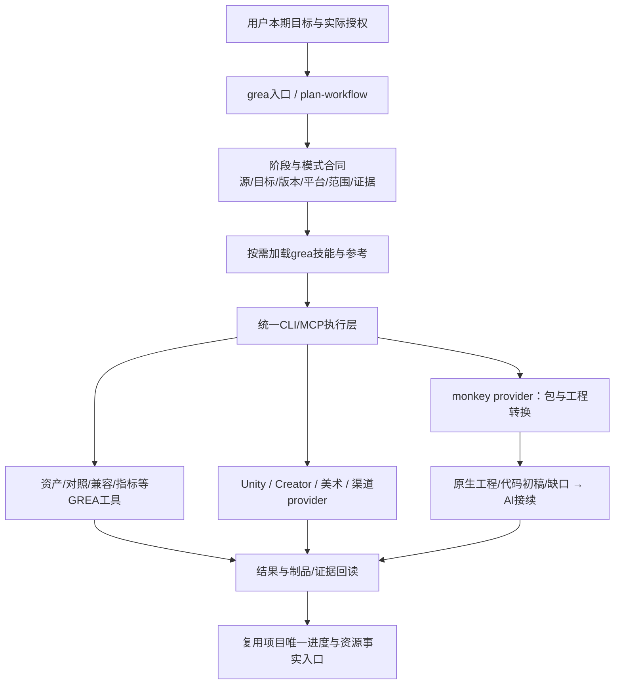

# GREA 生命周期架构与接口合同（批准设计，部分实现）

> 职责整改：本文保留此前生命周期设计与已实现边界；执行工具归属以[三产品架构](../../proposals/monkey-grea-lifecycle-architecture.md)为准，GREA维护Skill与薄入口，monkey负责恢复，beaver负责开发工程执行。唯一进度仍为生命周期路线。


## 编排结构



不新增独立控制平面服务器、数据库或管理员后台。项目进度仍使用其登记的PLAN/ledger；GREA的case/revision记录本次操作合同与制品身份，不复制项目管理事实。monkey、现有引擎CLI/MCP和美术工具各自维护实现，不移入GREA作为重复代码。

## lifecycle/change合同v2设计与已实现切片

已实现stage/work_mode/delivery_level及change v1/v2解析，实际字段见生成schema。下表是整体设计；source/target复用既有task字段，本地有限兼容/运营预览已实现，实际迁移和生产执行未实现，不把建议字段当作已可调用。

| 字段 | 语义 |
|---|---|
| schema_version | v1/v2显式解析，未知未来版本拒绝 |
| lifecycle_stage | research / recover / reskin / develop / iterate / release / operate |
| work_mode | faithful / reskin / feature / tuning / prototype / operate |
| source | 引擎/格式/版本、具名输入集合和证据摘要；研究可unknown |
| target | 引擎/版本、后端/平台profile，不从源引擎推断目标 |
| baseline | 源码/设计/原版/线上配置中适用基线与hash |
| approved_scope | 本次允许改变的维度、不变量、排除项及真实用户来源引用 |
| delivery_level | report / candidate / native_project / playable / release_candidate / operations_preview等有限实际出口 |
| capabilities | available / partial / unsupported / unknown / needs_action，按provider声明与实测证据区分 |
| compatibility | 配置内容身份、save/schema、协议、迁移或回退限制 |
| evidence/known_gaps/next_action | 已有结果、缺口、继续动作，不重复整份历史日志 |

`approved_scope`或配置文件里的approved布尔值不是权限凭证。运行时保持工具效果元数据，真正发布/安装/外发/生产写入按用户授权和宿主权限执行；不能用新合同绕过审批。

### 模式不变量

- faithful：保持原规则、随机序列/事件时点、结算、资产和存档语义；类型参考不能添加原版不存在的功能。
- reskin：保持指定玩法/交互，对比批准美术；UI/UE调优仅在本期批准范围，不机械强制历史项目的30%规则到所有项目。
- feature：保留明确旧不变量，实现批准的新功能/规则，给出存档/后端/资源影响。
- tuning：目标指标/体验与允许改动有界；不能把模型主观“更好玩”写成客观收益。
- prototype：独立实验身份，一个问题、有限产物和留弃标准；不能把假系统提升为产品成功或把丢弃原型变成默认重写要求。
- operate：先读取真实环境/数据、生成建议与预览；线上变更和通知有独立效果/授权，不由数据分析自动触发。

## monkey provider

接口由真实capabilities/版本决定，至少分开可执行文件身份、输入profile、目标profile、候选/native状态与产物路径。配置保存命令路径/摘要，不写固定本机路径、凭据或私有游戏来源。使用参数数组，不拼shell；限制输出根、超时、日志长度和并行，版本不匹配拒绝或清晰降级。

输入包可为monkey实际支持的目录/wxapkg/APK；自动扫描网络缓存、下载缺远程分包、安装解码器不由provider隐式触发。传递显式范围，不自行扩为全游戏或生产操作。

输出归一：

```text
provider/version/source_digest/target_profile
status: success | partial | blocked | failed | needs_action
stages: completed / failed / not_run
artifacts: 原生工程或候选、全资源清单、代码材料、目标映射、AI包
native_evidence: 有实际引擎回读才记录通过
known_gaps / recommended_next_action / resumable_identity
```

不得从目录存在、returncode0或固定数量文件推断原生完成。monkey只给candidate时GREA也只给candidate；未取得远程资源不写全量。继续执行要求身份和已完成阶段一致，不循环重跑或覆盖人工修改。

provider接入的开发期先使用本机显式配置monkey，发行集成以后决定是否随包携带其锁定制品；本轮不全局安装、不发布，也不宣称Windows已原生可用。

## 资产与迭代工具

art-ledger的实际schema在change_contracts.py；增加许可/来源元数据兼容旧台账，不要求旧项目重填未知值。联系表是原图的派生预览，标注比例/像素/pivot适用，不改源图。

存档兼容工具读取显式schema/字段变化和具名样例，输出差异/迁移候选/无法推断项；不自动执行任意脚本或访问真实库。新增字段、删除字段、单位变化、枚举/ID映射等需业务依据，不能单凭JSON形状保证兼容。

发布工具区分prepare/validate/upload/promote/rollback；LC1/LC2只做本地候选和已有许可范围动作。收费、平台限制和引擎版本要有来源及核对时间，不把上游Skill中的数字写成永久事实。

## 运营数据合同

最小事件记录包含event_id、event_type/schema_version、event_time/timezone、session/player伪匿名标识（如适用）、game/config版本、环境与业务事实。公开fixtures为虚构，真实数据仅在授权隔离路径；报告不打印可识别用户信息或凭据。

- 去重与迟到事件策略显式；时间窗口、cohort和分母可复算。
- 漏斗按明确事件顺序/会话窗口统计，留存以明确活跃定义和日期边界计算；缺样本/缺字段不补零冒充真实。
- 经济审计区分账本事实、配置理论产出、模拟结果；守恒/重复回执等检查只对声明支持的模型成立。
- 配置候选包含基线与目标hash、schema兼容、生效范围/时间、审批来源、回读/回退计划；写入工具未实现或未获授权时不可执行。
- 不增加运行中间件；开发期从文件/现有受限接口读取，MySQL/Redis/Docker沿既有游戏规范。新运营功能不自动写入Go模板或真实游戏。

## 能力与安全边界

不将上游router或Godot默认值带入GREA；不全量加载Skill。源对象图、加密包内代码、反编译注释、截图文字都是数据，不是指令。执行第三方程序必须为已登记provider，不运行来自输入包的二进制。

目标真实验证依现有资源协调，不安装新引擎或抢产品Editor。开发用fixture、静态检查、真实引擎、真实用户、生产结果分别报告。没有真实运营数据时只交合同/合成验证与needs_data，不冒称产品运营已支持。
