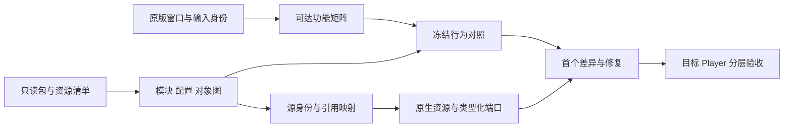

# Cocos 到 Unity：有限转换与行为保持

本页从一个 Cocos 2.4 系列样本提炼方法。它不是可直接执行的转换器，也不声称支持 Cocos 3.x、所有压缩/混淆形式或全部引擎 API。现行约束仍见 [跨引擎规范](../../../plugin/skills/grea-native-port/references/05-Unity-跨引擎移植与行为一致性.md)。

已查材料以发布包、提取的模块工厂、配置和序列化对象图为来源，未取得可直接打开的完整原作者 Cocos 制作工程。因此这里沉淀的是“发布产物取证与恢复到 Unity”的路线，不能把它宣传为任意 Cocos 工程的一键转换。若后续取得原制作工程，应另行核验场景、编辑器配置、源脚本、插件和资源导入身份。

## 应保存的证据链

每一步记录输入/输出 hash、工具与版本、范围、失败和未覆盖项。包缓存版本、游戏显示版本、源引擎版本、目标 Editor、工作树与 Player 是不同身份。脚本能打开一个隐藏面板不证明玩家能进入；缺分包也不能凭已有资源数宣布全量提取完成（E01、E15、E16）。

## 推荐迁移路线

| 工作 | 方法 | 退出条件与反例 |
| --- | --- | --- |
| 确认来源 | 同版本原窗口、包清单、资源引用、服务能力和可达前置 | 缺源/休眠/服务阻塞有独立状态；不猜测“看不到就是没有” |
| 结构恢复 | 按 bundle/资产/节点/组件/实例定位，保留原路径与 ID 映射 | 重复/冲突/未解析身份可定位；字符串字面量之外的注册形式被覆盖 |
| 代表视图转换 | 先选含图片、文字、遮罩、列表、按钮与输入框的少量页面 | 生产资源可编辑且实际加载；不仅生成文件 |
| 规则冻结 | 在隔离环境执行明确允许的参考代码或人工记录，冻结输入/桩/时钟/RNG | 对照环境的修改与限制可追溯；来源代码不能获得无界网络/文件权限 |
| 强类型移植 | 按业务切片把状态/用例/端口分离，使用原输入进行差分 | 返回值、状态、消耗/奖励、存档、随机与时序分别相同或差异获批 |
| 集成与退役 | 来源元数据保留；旧执行桥退出运行/生成/构建路径 | Player 实际包体与程序集检查；老脚本不能再覆盖人工实现 |
| 目标体验 | 从实际入口检查再进入、失败、关闭重开、动态与音频 | 测试桩、QA 高级档、真实输入、自然进度不混记 |

样本曾经过“参考解释执行 → 静态转写但保留动态值 → 强类型分层”的历史路线（E15）。这说明“退出 JS 解释器”和“形成可维护领域类型”是两件事。**未来项目不必重复全部中间阶段**：源逻辑可直接梳理的模块优先直接建明确契约；兼容层只承担已经观察到的必要行为。

## 引擎语义映射清单

| 来源概念 | Unity 目标/边界 | 必须核对的语义 |
| --- | --- | --- |
| bundle/UUID/压缩类 ID、`__id__` / `__uuid__` | 导入索引、SourceIdentity、Unity GUID/local fileID | 身份命名空间、实例索引、常量注册、别名冲突、递归对象引用 |
| Node、active、父子关系、z/sibling | GameObject/Transform 与来源顺序适配 | 场景包装节点不冒充源节点；激活、交换移除、帧尾排序、重入 dirty |
| Label/RichText/EditBox | TMP_Text/TMP_InputField 与文本度量适配 | 原绝对 lineHeight 与附加 spacing、空格、宽高、换行、结束输入、IME、最大长度 |
| Sprite/Mask/Widget/Layout | Image/Graphic/Mask/RectTransform 与必要兼容组件 | trim/original size、pivot、border、fill、圆形遮罩、更新时机、同数量重建 |
| Button/Toggle/Slider/触摸 | uGUI 控件、输入路由、类型化 Command | 目标组件、常量参数、捕获/冒泡、down/up/cancel、拖出、反馈与静音 |
| Pool | 显式租约与回收钩子 | put/get 是否改变 active/parent，监听与 Tween 复位；不是简单 SetActive(false) |
| schedule/update/lateUpdate/Promise | 可审计 Scheduler、帧阶段、微任务边界 | 停用/暂停/销毁、剩余时间、同帧新增/移除、异常拒绝、完成回调 |
| Tween/AnimationClip | 表现时间轴/原生播放器及数据转换 | 再次 start、中途重启、并行剩余时间、离散颜色键、完成/取消/回池 |
| Spine/加法混合 | 对应版本 runtime 与材质桥 | skeleton/atlas/page/attachment/animation、PMA/additive、alpha0的RGB贡献、Canvas剔除 |
| JS number/对象/数组 | 明确的 C# 类型与边界 codec | 缺失/null/undefined、truthiness、int32位运算、取整、排序/遍历与浮点精度 |
| 原平台 API | 能力端口和项目适配 | 已完成/失败/取消/不可用、重复回调、主循环时序；离线替代不是实服 |
| 保存与应用身份 | schema codec、平台存储端口 | 原 key、产品改名路径、损坏/旧版本、保存阶段和普通/QA档隔离 |

以上是排查目录，不意味着新模板必须仿写完整 Cocos。保留来源细节的代码应限于兼容适配；数值战斗通用业务不能依赖某个源节点索引或压缩类 ID。

## 失败案例如何变成回归合同

| 已记录现象 | 应定位的第一问题 | 最小回归与边界 | 证据 |
| --- | --- | --- | --- |
| 首领奖励后暂停不解除 | 组件身份漏表使弹窗请求先失败，后续关闭回调未发生 | 未解析身份预检、弹窗创建失败后恢复；不添加死亡延迟掩盖 | E15 |
| 规则抽取结果随后分叉 | 随机比较器调度/共享随机消费不同 | 变化随机序列、比较次数、消费序号、下一状态；同种子不足 | E06、E15 |
| 文本“乱码”但字符串正常 | 重建后的对象身份和布局缓存 | 同数量销毁重建两轮、节点几何、换行/空格；别先换字体 | E18 |
| 透明箭/特效消失 | 加法混合与 Canvas 网格剔除 | 原资源身份、shader/顶点色、首次与回池；截图存在不证明自然技能可达 | E18 |
| 修改 Variant 后运行没变化 | 源图重放覆盖人工编辑 | Author Capture → 生产 resolver → 回读恢复；给未知字段明确限制 | E05 |
| 原生类型壳仍调用动态工厂 | 实际业务入口未退出旧桥 | 输入/规则调用链、生成器和包体联合审计；编译不是退役证明 | E02、E15 |

这些是特定条件下的因果记录，不构成跨版本万能修复。新增来源要重新确认格式和调用方。

## 后续完善阶段暴露的合同缺口

第二次复评已取得图标尺寸和页面组合的修复报告及对应源码（E25–E27、E30）：

- 源Sprite的CUSTOM/TRIMMED/RAW模式必须按源版本确认；作者框、原图、裁切和Unity导入rect不是同一个尺寸。初始化、地址/ID换图、动画换帧和远程图均需调用一致语义。
- 缺handler与源无目标事件不同：前者是迁移缺口，后者可能在原版就是惰性声明。只有精确来源指纹和原行为依据才能例外，不增加“缺谁就忽略”的通用fallback。
- 页面的动态卡片可能在根绑定之后才创建；每个子实例均要检查controller、字段与监听。跨模块窗口必须完成业务组合，不能只有外壳。
- 原Button语义与目标Graphic命中资格要分别恢复。增大点击框、给所有Graphic开射线会改变其他控件和滚动行为，不能作为默认补丁。
- 更换外观后要更新Presenter的当前选择，后续升级/预览/存档依最新状态；外观已经刷新不证明状态同步完整。
- 原版网络错误文案可能包装本地组合失败；定位第一处异常再决定重试，不误改服务、网络或消耗规则。

这些是从成熟度更高的候选中得到的增量，说明“代码已分层”和“全部入口接线完成”必须分别检查。新增合成反例见 [UI回归合同](examples/ui-regression-contracts.example.json)，本轮没有重新执行其运行测试。

## 对照设计

每个差分 case 至少有：来源 hash、原始/已适配 oracle 类型、环境桩、初始状态、命令序列、时钟输入、RNG 序列、预期输出与字段容差。输出对照包括状态、消耗、奖励、保存请求、事件序号和随机消费；浮点容差按字段说明，不能用整体“近似相同”隐藏离散选择变化。

冻结 oracle 可能本身含旧适配错误，所以同时保留原版窗口证据和不独立项。机械 token 等价只证明文本变换约束，不能证明算法、真实输入或原版渲染正确。合成示例的数字与事件只演示结构，不是已运行测试（见 [示例](examples/README.md)）。

## 配置和资产的可维护出口

导出资源图、配置和类身份后，生产使用明确 DTO/Catalog 与原生资源。来源映射可以保留为溯源数据；不要求游戏持续加载解包目录、项目 Tools 或源 JS。原语言表、音频和远程资源地址只作为该项目证据，通用模板用自己编写的数据与资源 key。

工作 Variant 的覆盖范围应被列出并回读：位置、尺寸、pivot、显隐、文本等已支持字段与未知字段分别处理，不能声称任意 Inspector 修改都能捕获。正式 Build 校验已制作内容，重新转写只输出候选，且旧“写回活动目录”入口明确禁用（E05、E07、E15）。
