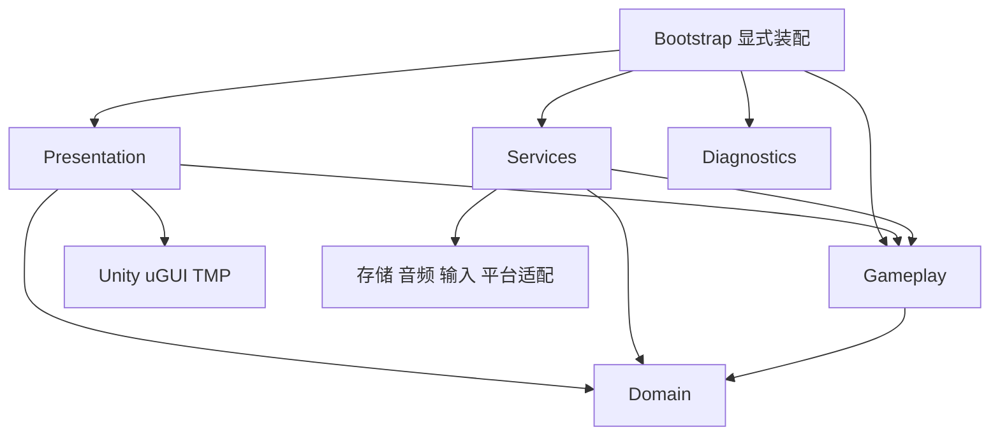

# 数值战斗模板架构

本页是 `0.1.0-draft.2` 的实现提案，不改变现行 [工程标准](../../../plugin/skills/grea-unity-standard/references/05-Unity-工程结构与开发规范.md)。证据编号在 [索引](证据索引.md)解释；下列新增接口名称都是设计名，未发布。

## 提炼范围

样本最有价值的是规则、内容、UI 和平台边界之间的连接方式。源码已具备六个运行程序集，其中 Domain 与 Gameplay 不引用 Unity；UI 输入有订阅所有者和代次撤销；配置与工作 Variant 有编辑后进入运行解析的回读记录。上述是可提炼基础。样本仍有项目专用源图、原逻辑键、集中组合代码和奖励窗口耦合，不能直接作为通用框架（E02–E05、E10）。

| 层次 | 拟提供的内容 | 不放入这一层 |
| --- | --- | --- |
| 通用框架 | 作用域、取消与句柄、资源/音频/存档端口、UI 壳与绑定规则 | 技能公式、装备品质、广告额度、具体游戏类名 |
| 模板配方 | 有实际消费者的战斗、背包、成长、奖励、导航骨架及合成配置 | 原游戏配置值、源代码、原美术和精确原布局 |
| 恢复适配 | 来源身份映射、原时钟/RNG/调度语义、特定引擎数据转换 | 默认启用的解释器、假定所有 Cocos 版本都兼容的全局桥 |
| 项目扩展 | 当前游戏规则、资产、授权服务、迁移与差分证据 | 对 grea 安装副本的手工修改 |

## 目录与编译依赖

以下是**目标内容树**，只有启用且有实现/内容的模块才创建目录。SourceMappings 和恢复适配在有来源输入时才出现。历史取证、构建和 QA 不进 Assets。

```text
Project/
  grea-project.json                  # 后续契约扩展通过后才生成
  Docs/                             # 项目计划、结构和验收
  Evidence/                         # 原始、派生、运行证据分开
  Build/                            # 单次构建身份与交付
  Tools/                            # 项目专用解析与维护
  UnityProject/
    Assets/Game/
      Bootstrap/                    # 唯一组合入口、AppFlow
      Domain/{Battle,Inventory,Progression,Economy,Configuration}/
      Gameplay/{Battle,Inventory,Progression,Rewards,Navigation}/
      Services/{Assets,Persistence,Configuration,Audio,Input,Platform}/
      Presentation/{Battle,UI,Animation}/
      Diagnostics/                  # 有界结构化事件，不改玩家状态
      Content/
        Config/{Tables,Views,Themes}/
        Prefabs/{UI,Battle}/         # 按需设置 Templates/Variants
        Sprites/ Fonts/ Audio/ Materials/ Animations/
        SourceMappings/             # 可选来源身份，不是执行脚本
      Scenes/{Bootstrap,Entry}.unity
      Editor/{Authoring,Generators,Validators,Build}/
      Tests/{EditMode,PlayMode}/
    Assets/GreaGenerated/            # 配方实际拥有的基础壳/配置
    Packages/                       # com.grea.* 与锁定上游依赖
    ProjectSettings/
    Tools/Generated/manifests/       # 生成身份和所有权
```

单层内再按模块组织；不增加含义重复的 Runtime/Game/UI 目录。工作文件采用用途名，例如 `InventoryPageView`、`RewardTable`、`AudioSettings`；运行 key、来源 UUID、Unity GUID 和文件名分别管理（E13）。



- `Game.Domain`：纯 C# 值、状态、配置 DTO、不变量；`noEngineReferences=true`。
- `Game.Gameplay`：用例、会话、跨层端口；只依赖 Domain 和必要的纯框架 Contracts。
- `Game.Services`：实现端口。不同 SDK 适配先按目录隔离；出现真实独立编译需要再拆包，不反向调用 Presentation。
- `Game.Presentation`：View、Presenter、输入到命令转换、战斗渲染；不能读写存档文件或直接调用广告 SDK。
- `Game.Bootstrap`：选择具体实现、启动顺序、Scope 和销毁；业务层不能反向引用它。装配按模块拆 composition，避免全项目静态 ServiceLocator。
- `Game.Diagnostics`：接收结构化事件和快照，默认无 Unity 依赖；UI 诊断视图另属 Presentation/Editor。
- `Game.Editor` 与 Tests 单独编译；Player 包体检查实际文件与程序集引用，不仅检查 asmdef 文本。

类型与程序集移动须经过 Unity 序列化回读，目录整齐不能代替依赖检查。上图是拟定依赖，不代表样本每个细节都应直接复制。

## 模块边界

| 模块 | 输入与输出 | 状态所有者 | 必验失败/重入 |
| --- | --- | --- | --- |
| AppFlow | 启动、主页、战斗、结果、返回意图 → 应用状态 | ApplicationScope | 存档加载失败、进入中取消、初始化半途失败 |
| Battle | 帧步长、玩家快照、技能命令 → 战斗快照/事件 | BattleScope | 暂停、复活、胜负互斥、结算一次、退出清理 |
| Inventory | 物品/装备 ID 与操作 → 差量和拒绝原因 | PlayerScope | 不足、上限、重复、装备替换、旧存档 |
| Progression | 升级/解锁命令 → 属性快照/消耗 | PlayerScope | 条件未满足、最大等级、配置缺引用 |
| Economy/Rewards | 资格、成本、奖励凭据 → 已提交结果 | PlayerScope 的事务服务 | 重复回调、保存失败、旧余额、重启重放 |
| Activities | 时间、任务事件 → 进度/可领状态 | PlayerScope | 跨日、时间回拨、领取后重开；按需启用 |
| Navigation | 路由、类型化参数 → 视图租约/关闭结果 | PageScope/ModalScope | 资源丢失、创建失败、关闭中再次请求 |
| Settings | 音量/开关 → 应用反馈和持久化设置 | PlayerScope | 静音重开、失焦恢复、不误改业务进度 |
| Platform | 明确的能力请求 → 结构化完成状态 | ApplicationScope 适配、用例持有请求 | 无服务、超时、取消、重复通知、切页晚回调 |

活动、商店、红点、引导为可选配方；未启用时不创建空控制器。先实现完整小闭环，再增加模块数量。

## 生命周期、时钟与随机

ApplicationScope 持有配置、资源服务和平台适配；PlayerScope 持有存档与长期状态；BattleScope 持有战斗实体、定时任务、暂停令牌与战斗表现；Page/Modal/ItemBindingScope 持有 UI 订阅、加载句柄和局部任务。

关闭顺序拟定为：撤销输入 → 使操作代次失效并请求取消 → 逆序释放子作用域与监听 → 归还资源/对象 → 报告关闭结果。失败走相同所有权清理，不能用销毁画面替代取消奖励请求。旧回调必须同时核验 owner、generation、operationId；仅从字典删除引用不能撤销已捕获闭包（E04）。

拟区分 `WallClock`（离线/跨日）、`GameplayClock`（暂停/倍速）、`PresentationClock`（UI/动画）。后台策略由 profile 显式选择并覆盖普通 Player、QA 与平台；不要把某个样本的后台运行策略当所有游戏默认值。时间回拨、上限和补偿规则属于项目配置，不能由通用框架猜测。

新配方可采用独立的玩法与表现随机流并记录种子、流版本和调用序号；**恢复适配必须保持原共享流**，包括原音乐、表现、排序比较器的随机消费和激活顺序。源码中的 swap-removal、微任务和帧尾排序属于来源语义，不能以“更稳定”名义改成另一种顺序（E06、E15）。

## UI 架构

拟采用 `View + Presenter + UseCase`：View 只收发类型化数据和输入；Presenter 管绑定/异步状态/错误展示；UseCase 决定资格、消耗、奖励与状态变化。复杂页面按面板子区域组合，不建立能反射任意方法名的全能 ViewModel。

| UI 类型 | 所有权与输入 | 展示规则 |
| --- | --- | --- |
| Page | 一个当前页，导航服务拥有替换；Tab 不持有玩家数据 | 页签选中由导航状态反推，不先改颜色后假装切页成功 |
| Modal | 租约、返回值、可选暂停引用、焦点栈 | 创建/绑定失败释放遮罩和暂停；多弹窗最后一个暂停引用释放后才恢复 |
| Overlay/Toast | 有界队列及 TTL；显式是否遮挡输入 | 提示本身不改奖励资格，超时或取消后不遗留挡板 |
| Recycled Item | bind 代次、稳定业务 ID、资源句柄 | 换数据前清旧监听/文字/图标/选择/动画；晚到图标不写入新条目 |
| Text/Input | 文本规则与设备输入适配分开 | 长文本、空白、IME、结束编辑、取消、焦点、滚动转发分别测试 |

页面状态至少区分 Loading、Ready、Empty、Unavailable、Failed；不能把空数据当加载成功。按钮处理中禁止重复命令；失败后重新可用；拖出/取消/禁用/失焦要复位视觉反馈。通用音效遵循 AudioSettings，不在每个按钮私建音源。

恢复 UI 可保留 `source asset + instance + component` 的身份到原生字段映射；普通模板采用稳定业务 slot 和序列化引用。来源字符串事件只在导入/兼容边界转换，运行时不默认按任意字符串反射调用。Coverage 应统计实际事件与控制器绑定，Prefab 数量不能代表交互覆盖（E04）。

### 组合完成、命中与状态更新

第二次复评补充（E24、E26、E27、E30）：`Created`只表示实例存在，`Bound`表示当前已知输入有所有者，`BusinessReady`还要求业务控制器、必要子项和跨模块端口已组合。延迟创建的卡片每次都经过自己的绑定检查；页面应明确全Ready、局部加载或失败，不能只检查根节点后宣布整个页面可用。

模块的打开入口拟区分 `PrepareSurface` 与 `OpenReadyView`，前者只创建壳，后者承诺业务可操作；名称是设计契约，不是新增grea API。跨模块奖励、任务、商城弹窗要通过后者或显式完成业务装配后再返回Ready。旧恢复流程的加载时序单独保持。

输入至少分四层记录：原事件声明 → 当前实例controller绑定 → EventSystem射线目标/遮挡/命中区域 → 用例状态变化。有效控制器缺失应失败；原版确实无目标而不执行的复制事件可以通过精确来源指纹声明例外，但不能全局忽略空目标。按钮可被代码调用，不代表玩家能点中。

Presenter要么读取当前不可变状态投影，要么在业务变更事件中同步自身选择与View。仅刷新图标而保留旧variant/level会让下一次升级预览使用旧值；测试覆盖“切换→执行动作→打开详情→关闭重开”的连续流程。

导航失败拟使用结构化原因，如配置/资源缺失、控制器缺失、已取消和暂时不可用。只有明确的暂时失败重试；本地契约错误立即给出route、component、operation及首因。恢复原外显文案与内部诊断分类可以并存，不把所有失败都归成网络问题。

## 奖励、广告与存档

新模板拟以 `ClaimRequest(operationId, claimKey, expectedRevision)` 请求事务：

1. 校验玩家、配置版本、资格和数量，解析确定的奖励，避免重试重新抽奖。
2. 外部广告适配只返回结果，不直接写库存；未观看完成、不可用、失败、取消均有独立状态。
3. 单写者事务中复核资格与版本，把库存差量、次数/限额和领取回执写入同一持久化快照。
4. 成功后发布不可变 `RewardReceipt` 供 UI 展示；相同 claimKey/operationId 重放只返回原结果，不再次入账。
5. 提交前取消不写入；提交后即使弹窗关闭也保留回执。超时且提交结果未知先查询原 operationId，不生成新 ID 重试。保存失败不显示领取成功。

这套事务是**新增设计**，现有 `FileSaveStore` 并不自动提供跨业务幂等账本、多文件事务或多写者并发（E08、E10）。首版只承诺一个进程内的单写者、一个聚合快照及明确恢复规则；设备掉电、真实广告服务端验证和云端并发需另行实现验收。

恢复模式若原规则在窗口加载后才展开掉落/发奖，必须先冻结该顺序，再决定是否单独批准行为重构；不能直接套上述新事务顺序后宣称原版等价。样本的离线广告成功是已批准的本地产品适配，**新模板默认无广告服务为 Unavailable**，演示模拟完成只在显式 QA 配置下出现（E09）。

存档按 schemaVersion 和独立 namespace 标识，配置版本另外记录；Missing 可建初始档，Corrupt/UnsupportedSchema/IOError 不能自动覆盖为空档。数据备份和显式恢复、业务 schema 迁移及平台路径兼容分别验收。文件名哈希不提供加密保护，也不代表防作弊完成。

## 组合根、依赖与维护复杂度

组合根只负责选择实现、建作用域和接线。来源字段解析/原常量留来源适配，规则/资格留Gameplay，图形构造留Presentation。大型组合类先按活动、奖励、成长等真实消费者拆出明确依赖，不为了缩短文件把共享全局状态分成partial；生成DTO/codec与人工代码分开治理（E24）。

Runtime消费的包直接记录在manifest/包声明中。可选Editor连接、IDE或分析工具的传递依赖不能作为游戏运行依赖的唯一入口；独立恢复要验证移除可选工具后的实际组合。profile中包版本集合与manifest/lock内容hash分别核验，版本相同但字节漂移仍需更新/复审身份（E22、E23）。

## 制作、生成与交付边界

Author 修改工作 Variant/配置，Validate 校验，Build 只打包已制作内容。必须证明“改值 → 保存 → 生产解析回读 → 恢复值”闭环；仅能在 Inspector 修改不足以证明运行时采用（E05）。

包源码按版本维护；项目业务骨架 seed-once；generated 文件只在未漂移且清单拥有时更新；人工 Variant 不自动 Apply 回基础资产。候选生成输出到明确的新目录，人工修改冲突即停止。正式配置与 Prefab 的创建/移动仍由 Editor API 完成。

源码分发必须仅靠自身 Assets、Packages、ProjectSettings 和说明恢复，不能依赖父项目 Analysis/Tools 或本机 grea 路径。Editor 编译、组件测试、Player 真实输入和原版差分各自留证。首个模板发布需要新的 A0–A4 结果，已有工程试点另需 A5。
