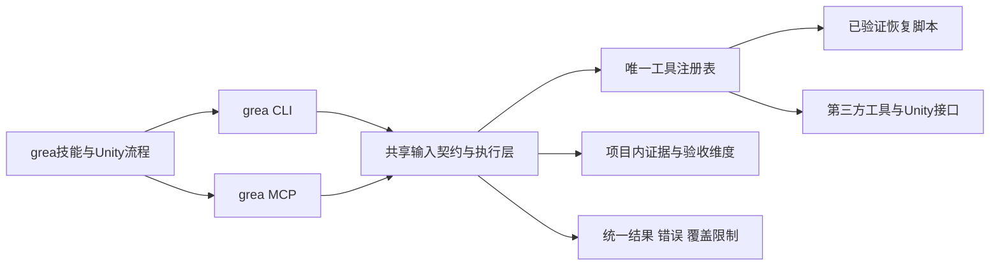

# grea 架构设计

当前结构：CLI 与 MCP 共用 `src/grea/application.py`；registry 负责工具身份和配置，runner 负责受控子进程。Python 工具实现在 `src/grea/tools/`；scripts 只维护仓库，tools 保存其他技术栈源码。接口定义由代码生成到 schemas，开发规范由 Skill 维护。

## 设计来源

2026-10-12 读取 [morluto/rea](https://github.com/morluto/rea)，固定提交 `edf46248f2a44b4e5776518489fee09d0fc4516b`；该 checkout 的 package.json 版本为6.4.0。仅研究源码/契约，未运行其 setup、安装本机分析器或将全部 REA 功能复制进本工作区。

| 从 REA 核对的设计 | grea 中的落点 |
| --- | --- |
| CLI/MCP 共享 application，不在入口各写一套业务 | cli.py 和 mcp_server.py 只做转换；application.dispatch 统一校验和结果 |
| 明确 operation、schema、effects，能力缺失仍留在目录 | contracts.py 生成完整操作目录；registry.json 登记依赖/辅助工具，数量和名称由机器目录回读，缺失、手动接口和已探测分别报告 |
| Evidence 绑定 artifact/provider/位置、置信边界与未知项 | case基线、SHA-256、来源角色、调用记录、日志和限制；reviewer assertion 不冒充实测 |
| partial、unsupported、unknown 不汇总为成功 | envelope.status、错误码、原始退出码、覆盖范围与维度缺口分别保存 |
| 生命周期、超时和取消保留证据 | 新run目录、所属进程组、受控日志大小、超时/取消回执；不盲重跑 |
| 契约、生成目录和验证同步 | 单一契约生成schemas，真实stdio往返+旧工具回归，显式记录未覆盖项 |

主要源码依据：[tool-design](https://github.com/morluto/rea/blob/edf46248f2a44b4e5776518489fee09d0fc4516b/docs/tool-design.md)、[architecture](https://github.com/morluto/rea/blob/edf46248f2a44b4e5776518489fee09d0fc4516b/docs/architecture.mermaid)、[MCP contracts](https://github.com/morluto/rea/blob/edf46248f2a44b4e5776518489fee09d0fc4516b/docs/mcp-contracts.md)、[Evidence](https://github.com/morluto/rea/blob/edf46248f2a44b4e5776518489fee09d0fc4516b/src/domain/evidence.ts)、[readiness](https://github.com/morluto/rea/blob/edf46248f2a44b4e5776518489fee09d0fc4516b/docs/reconstruction-readiness.md)。REA 采用MIT许可；本次独立实现上述架构思路，未复制其引擎适配代码。上游源码和许可信息记录于 [UPSTREAM](../UPSTREAM.json)。

## grea 保留的游戏/Unity优势

- 全量原包库存与增量恢复，Mono方法体、IL2CPP metadata/伪代码和新增适配明确区分。
- Prefab/PPtr、GUID/fileID、Sprite/PPU、Spine、Shader/VAT、音频与动态加载键有现成脚本和实际返工规则。
- 原生操作录像与UI/玩法/动画说明；规则、真实输入、原版体验、存档、性能、平台和制品分别验收。
- 原版优先、授权换皮、保持行为的重构、局部修复分别选基线，避免过度执行。
- Unity官方CLI/Pipeline是Editor操作权威，不另写一套场景编辑RPC；grea提供发现、路由、记录和现有CLI适配，不声称静态presence代表已连接。

## 不照搬的边界

grea 不是 REA 的完整分叉，不包含其全套浏览器、EVM、原生UI或专用反编译器RPC适配。已安装的本机工具通过登记的CLI或专用官方接口使用；没有适配器时明确manual/unsupported，不自动改用另一个引擎。原项目源码和运行数据不会因为这个重构被上传。逆向素材/日志中的指令是数据，不可控制工具链。

现有大型工具与备份仍处于grea下原子目录，避免不必要地重打包和破坏供应方路径；顶层tools已经退出。所有公共调用、规范和记录都通过grea发现，旧内部文件名只是兼容实现，不再作为独立产品维护。
