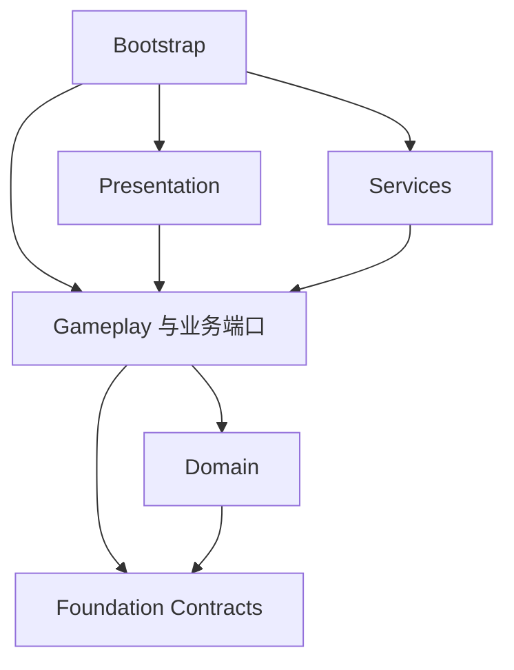

# Unity · 程序集分层与生命周期

> **何时读**：划分 Domain/Gameplay/Presentation/Services 等程序集、设计启动场景与作用域、处理异步取消、时间与随机、存档和输入事件契约时。
> **读完产出**：asmdef 依赖图、场景与启动契约、作用域与对象生命周期表、数据种类与唯一写入者说明、存档版本与迁移策略。

本篇属于 [工程标准 v1](05-Unity-工程结构与开发规范.md)（`grea-unity-project` 1.0.0）。目录见 [工程目录与资产归类](05-Unity-工程目录与资产归类.md)；跨引擎项目的技术选型以 [原生转换规范](../../grea-native-port/references/05-Unity-原生转换规范.md#技术选型基线) 为准。

## 开发框架与依赖方向

**ARC-01 默认分层**：以业务所有权划分模块，同一模块跨 Domain、Gameplay、Presentation 时沿用同一模块名。小模块可在同一层程序集内分目录，不为每个类建立接口或程序集；纯规则层和 Editor/测试隔离仍须成立。

| 程序集设计名 | 所有者职责 | 允许的直接依赖 |
| --- | --- | --- |
| Grea.Foundation.Contracts | 通用接口、结果、标识；无 Unity 类型 | System 与明确锁定的纯托管依赖 |
| Grea.Foundation.Runtime | Unity 生命周期适配与诊断实现 | Contracts、Unity Runtime |
| Game.Domain | 业务状态、规则、计算；不负责播放或持久化 | System；按需使用纯 Contracts |
| Game.Gameplay | 用例与会话编排、业务端口、事务结果 | Domain、纯 Contracts |
| Game.Services | 存档/资源/设备/平台的具体适配 | Gameplay 的端口、Domain 数据、基础包和相应 SDK |
| Game.Presentation | 输入到请求、状态到视图、动画桥接 | Gameplay、Domain 的只读数据、基础包及选定 UI 包 |
| Game.Diagnostics | 项目专用快照与诊断订阅 | 公开只读契约、基础诊断能力；不反向驱动玩法 |
| Game.Bootstrap | 创建并组合上述实现 | 需要装配的各运行程序集；其他业务层不得引用它 |
| Game.Editor / 测试程序集 | 生成、校验、构建；编辑态或运行态测试 | 被检查/测试的运行程序集；运行代码不得反向引用 |

图中的箭头表示静态引用方向；外部服务实现由 Bootstrap 注入 Gameplay 声明的端口，Gameplay 不引用 Services 的具体实现。

图省略了表中允许的其余引用，表为完整规则。`Game` 是示例命名空间前缀，应替换为项目配置值。公共包不得反向引用 Game；模块互相通过明确端口或只读结果协作，出现循环依赖先重新划分所有权，不能用全局服务定位器绕过依赖检查。

**ARC-02 编译隔离**：使用 asmdef 实施边界。Domain、Gameplay、Contracts 默认 noEngineReferences；Editor 仅在 Editor 平台编译；测试单独程序集且只在测试构建启用。只建立目录不算完成隔离；反射、预编译 DLL 与代码生成也要进入依赖审查。Unity 包的 Runtime/Editor/测试程序集应显式引用依赖，见 [官方程序集说明](https://docs.unity.com/en-us/engine/6000.0/manual/packages-list/cus-pkg-development/cus-asmdef)。

**ARC-03 接入策略**：v1 默认显式构造函数/初始化参数装配，不强制额外 DI 容器、ECS、响应式库或消息总线。已有框架按获准范围适配；小修复不顺带替换。确需第三方框架时记录版本、许可证、AOT/IL2CPP 与目标平台验证，避免同一工程并存多套初始化和资源生命周期。跨引擎项目的默认插件见 [技术选型基线](../../grea-native-port/references/05-Unity-原生转换规范.md#技术选型基线)，grea 组件与这些插件的取舍见 [自研框架与主流插件的关系](05-Unity-通用组件与Prefab.md#自研框架与主流插件的关系)，许可证登记见 [许可证与再分发](../../grea-delivery/references/09-交付-许可证与再分发.md#3-第三方包)。

### 场景与启动契约

默认使用配置声明的 Bootstrap 入口创建应用作用域，再加载实际内容场景；入口场景名称、加载方式和 build 场景清单由项目配置锁定，不靠数组下标或全场搜索推断。持久服务与内容场景对象有明确所有者，切场景不重复创建音频、输入或资源服务。

单独打开内容场景的 Editor 预览必须显式提供预览装配和隔离存档，不能偷偷生成生产全局对象；普通 Player 只沿正式启动链。原工程已有启动场景或固定加载顺序时先登记并适配，不能为了模板改写原初始化时序。

## 生命周期与数据契约

**LIF-01 作用域**：应用作用域拥有共享服务；会话/关卡作用域拥有玩法状态与任务；界面作用域拥有绑定与表现任务。创建者明确持有并释放资源，子作用域不得长于父作用域。跨作用域借用不得冒充所有权。

| 对象 | 状态及进入条件 | 退出与失败处理 |
| --- | --- | --- |
| 应用服务 | Created → Initializing → Ready | Stopping → Stopped；初始化失败进入 Faulted，并逆序释放已成功初始化项 |
| 玩法会话 | Created → Loading → Running；需要暂停时进入 Paused | 退出先阻止新命令，再取消待执行任务、清理表现并按项目事务规则结束 |
| 界面 | Unbound → Bound → Visible → Hidden → Unbound | 关闭清理本次显示订阅/任务；复用前复位；销毁后旧回调不能再写视图 |
| 池化实例 | Available → Rented → Returning → Available | 租约只允许归还一次；宿主退出清理活跃项，超额/失效对象执行明确销毁策略 |

状态名称是框架语义，不强制替换原游戏已有状态值。Bind/Unbind 与 Show/Hide 的责任必须分开；重复初始化/重复关闭应无副作用或返回明确状态错误，不能重复注册监听、创建服务或结算。Awake/OnEnable 只做局部初始化或绑定；跨模块的顺序由 Bootstrap/会话编排决定，不能依赖未声明的脚本执行顺序。

**LIF-02 取消与回调**：每项异步操作关联 operationId 和所属作用域；界面关闭、换关、对象归还、应用退出均有对应取消策略。晚到结果检查作用域代次与对象有效性；取消不等于成功，不触发完成奖励。业务提交点之前可取消，提交后按幂等结果处理；跨服务事务失败的补偿规则由 Gameplay 定义。动画事件驱动的完成不能被任意固定延迟替换。

清理模型也可能同步发布事件。进入销毁时先关闭新命令/表现回调入口，再取消任务、解除订阅并按所有权依赖释放；用 finally 或等价保障使一项异常不截断其余必要清理，重复释放与迟到回调均不能再次写入视图。Unity 对象已销毁的“假空”与托管引用不等价，不能因此跳过仍持有的托管事件解绑。Tween、Spine、协程和池化对象分别核对自己的注册者与释放者，不规定跨项目共用一个销毁实现。

涉及这些路径的改动，选择一条受影响定向用例及所交付普通包中的活跃任务退出路线，检查完整关闭尾日志和进程状态；开发包测试、场景重建或进程消失不能单独证明清理通过。正常信息日志不当异常，未归因的引擎/供应方警告另记 unknown，不能为消警而修改第三方或关闭检查。

**LIF-03 时间与随机**：区分玩法时钟、表现时钟与真实时间；暂停和后台策略显式配置。恢复工程在玩法规则层（Domain/Gameplay）保留原共享 RNG 的状态、调用顺序和消费关系；表现随机仅在不改变原语义时隔离。表现层的帧阶段、组件生命周期顺序与调度器实现使用 Unity 原生机制，不复刻源引擎；会影响规则结果的顺序在 Gameplay 中显式编排。可注入时钟/RNG用于测试，但生产路径不能偷偷切换种子或时基。

**LIF-04 编辑器重入**：记录进入 Play 的 Domain Reload/Scene Reload 配置；静态缓存、单例持有和事件订阅必须在所选配置下可重置。重复进入/退出 Play、同进程再开一局与真正关闭 Player 后重开分别测试。不能把测试进程重启清空静态状态当作生命周期清理正确的证明。

**DAT-01 数据种类**：配置资产（ScriptableObject/JSON）、可变运行状态、持久化 DTO、UI 视图数据分别定义。配置不保存玩家运行进度；退出 Play 后不能把测试状态写回配置资产。数据必须有唯一写入所有者；View 发出请求，Gameplay 调用规则并提交状态，视图根据结果刷新。

**DAT-02 存档**：定义 schemaVersion、迁移器、备份/恢复与校验失败策略；先写独立临时内容再按目标平台支持的方式提交，验证异常中断恢复。QA 使用独立 save namespace。已有恢复工程通过适配器保留旧存档键、编码和原子性语义，不能因为统一 DTO 自动改写玩家存档；迁移另行确认范围并验证关闭重开。

**DAT-03 输入和事件**：输入设备事件先转成明确业务命令，包含执行者和必要上下文。模块内优先直接调用/类型化订阅；跨模块事件说明发送者、订阅者、顺序、线程、重复与取消语义。禁止 View 在多个回调分支重复扣费、保存或发奖；不要用无边界全局事件总线隐藏控制流。
