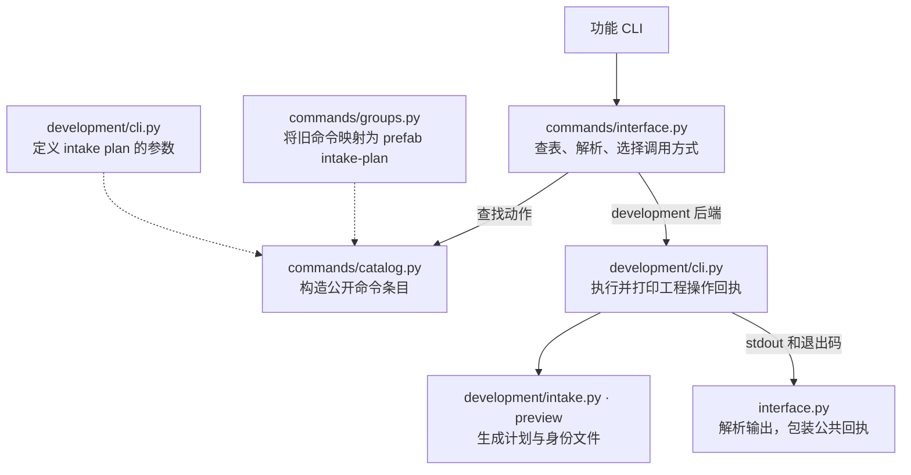
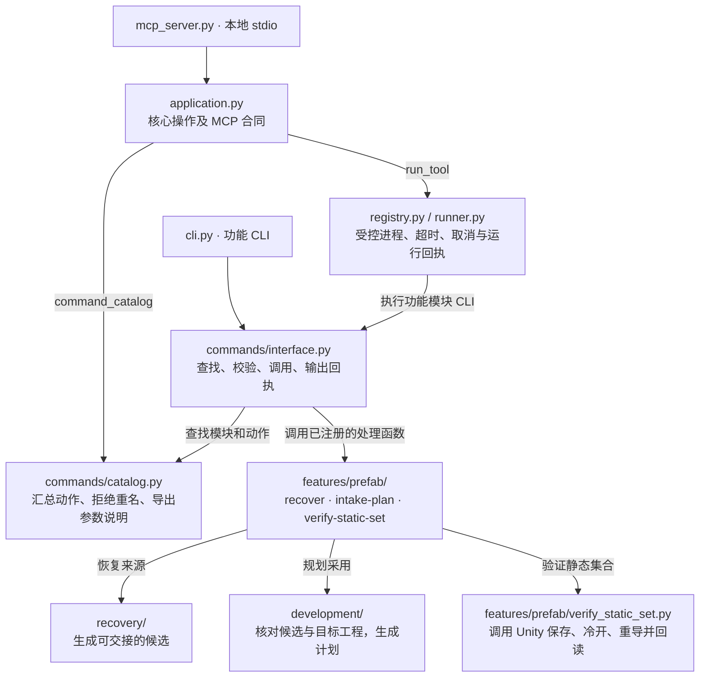

# GREA 命令架构重构设计

本文保留命令架构设计及最初试点依据。2026-11-06 试点基线为 `v1.1.0.dev2`、提交 `2a2c3f1`（292 个动作）；2026-11-07 全模块迁移基线为 `8a790be`（300 个动作）。当前维护结构见[维护与发布](../../docs/维护与发布.md#功能模块与依赖方向)，实施和验收状态只由[唯一任务源](../lifecycle-roadmap.md)维护。

## 设计目标

开发者看到 `grea prefab intake-plan`，应当能从 `features/prefab/` 找到它接受哪些参数、调用哪个函数、返回什么，以及哪些文件会被写入。CLI 帮助、JSON 命令目录和 MCP 查询应从同一处得到答案。

按功能模块声明公开动作，保留恢复与工程事务各自的实现边界。先以独立动作验证，再推广到其他模块。五个 Skill 继续组织工作流程，公开命令继续按操作对象分组。

## 迁移前：一个动作如何被找到和执行

基线命令目录有 14 个模块、292 个动作。目录从恢复、工程、专项工具等多套解析器和核心操作合同中汇总条目。下图只追踪 `prefab intake-plan`，虚线表示构造目录时读取定义，实线表示运行时调用。

源参数、公开名称和真正的处理函数分别位于三处。查命令的人必须了解旧分派方式，改参数的人还要核对请求文件、帮助和 MCP 暴露出的契约。现有目录已经能生成一致的文档，这项能力值得保留。[命令注册](../../src/grea/commands/catalog.py) · [分组映射](../../src/grea/commands/groups.py) · [执行入口](../../src/grea/commands/interface.py)

## 目标：功能模块拥有动作定义

| 代码归属 | 负责的决定 |
| --- | --- |
| `features/<模块>/` | 声明公开名、真实参数解析器、处理函数和操作结果；模块专有算法就近维护。 |
| `commands/` | 注册与查询、重名检查、参数输入、通用回执、帮助与文档生成。模块登记在 `features/catalog.py`，无需增加按后端类型选择调用方式的分支。 |
| `recovery/` | 负责源格式、依赖闭包和恢复算法；以候选、来源身份和缺口记录交接。 |
| `development/` | 负责工程采用与受控写入；拥有计划校验、事务日志、重试与回滚语义。 |
| `application.py`、`contracts.py` | 保留核心操作的输入 Schema、MCP 分派及响应封装。 |
| `runner.py`、`host/` | 保留进程隔离、取消、超时、输出限制和平台操作。旧固定工具入口继续使用原参数及回执。 |

### 注册和返回约定

1. 试点在 `features/prefab/commands.py` 显式导出动作，复用现有 `Command` 可表达的字段。参数只声明一次；公共 CLI 和旧阶段 CLI 分别实例化解析器，以保留各自的帮助、别名和错误格式。目录、MCP 查询及文档从公共解析器读取参数。
2. 公共目录显式收集模块导出的动作。迁移一个动作时，同一修改移除它的旧目录映射；重复的 `(module, action)` 直接报错。旧入口有自己的调用名，但落到同一业务函数。
3. 已迁移动作的处理函数返回 `CommandResult(value, exit_code, diagnostics)`。CLI 在边界打印一次。现有开发操作的内层回执仍须保留，包括生产者身份、产物、验证状态和错误位置。恢复和开发动作直接返回结果；仍打印结果的专项脚本与静态绑定兼容入口集中在 `features/adapters.py`，不把兼容分支放回公共接口。
4. MCP 的 `command_catalog` 使用同一目录；`run_tool` 执行模块命令时保留隔离运行目录、取消、预算和外层进程回执。CLI 与 MCP 比较同一个内层动作结果，同时分别验证传输层合同。[MCP 实现](../../src/grea/mcp_server.py) · [进程执行器](../../src/grea/runner.py)

## 试点：`prefab intake-plan`

选这个动作有两个原因：它已经有独立的 [`development.intake.preview()`](../../src/grea/development/intake.py)，而且只生成计划，能在隔离目录里验证完整路径。基线工作树中的 `verify-static-set` 正有在途修改；它与 `intake-apply`、`intake-rollback` 都排在试点之外。

| 项目 | 试点合同 |
| --- | --- |
| 输入 | 必填 `--candidate`、`--target`、`--spec`、`--output`。保留 `--out` 别名、`--request` 文件输入以及可选的 `--package-evidence`、`--expected-package-evidence`，沿用现有配对与摘要检查。 |
| 调用 | 显式动作把已校验的参数交给 `preview(candidate, target, spec, output, package_evidence, expected_package_evidence)`。参数拼写归接口；规格版本、引用和候选归属校验归工程实现。 |
| 成功 | 在新输出目录产生 `intake-plan.json` 与 `plan-identity.json`；回执携带计划路径、SHA、分项数量及 `native=not_run`。候选与目标工程在调用前后做摘要比对。 |
| 失败 | 参数冲突在调用业务前拒绝；无效规格、摘要不符、输出目录已占用沿用既有分类。核对诊断、退出码与实际写入，保存失败证据；部分输出目录不作为成功计划复用。 |

## 迁移与验收

| 步骤 | 做法 | 通过条件 |
| --- | --- | --- |
| 1. 固定基线 | 从当前版本导出命令目录；对隔离候选记录公共 CLI、请求文件、旧阶段入口、MCP 的成功与拒绝结果。覆盖既有 intake 规格版本。 | 保存可重复的输入、原始回执和产物摘要；明确哪些字段依赖运行目录或实现身份。 |
| 2. 切换一个动作 | 新增试点声明，移除其旧公开映射；旧阶段 CLI 复用参数和业务实现。 | 公开目录只出现一次 `prefab intake-plan`。名字、参数、别名、默认值与互斥规则逐项对齐；命令参考生成检查通过。 |
| 3. 比较执行结果 | 使用同一冻结输入，在不同新输出目录运行新旧入口；比较计划、内层操作回执、退出码和写入范围。再经真实 stdio MCP 查询合同、执行模块动作。 | 路径差异按字段解释。对相同输入与相同生产者身份要求计划 SHA 相同；身份变化时保留两份原始 SHA，仅接受能追溯到路径或身份的差异。错误参数无目标写入；已有目录不覆盖。 |
| 4. 决定推广 | 确认试点无需再从旧阶段 CLI 反查公开定义；检查现有恢复、工程及核心操作仍可查询。 | 新增动作只改所属功能模块与必要登记。试点的旧公开映射已删除；整类后端分支等最后一个依赖它的动作迁完再移除。达不到这两点就停在试点。 |

复用[命令目录与 CLI/MCP 等价测试](../../tests/test_command_modules.py)、[工程采用测试](../../tests/development/test_intake.py)和[命令参考生成器](../../scripts/generate_command_reference.py)。真实 MCP 测试现已覆盖 `system version` 和 `prefab intake-plan` 的计划 SHA；[架构约束测试](../../tests/test_command_architecture.py)另覆盖所有权、结构化执行、旧参数及指纹。本文列出的验收是实施门槛。

## 兼容、回退与范围

- **固定身份。** 工程实现身份原来仅覆盖 `development/`；命令迁出后扩展到 `development/`、`features/`、`commands/`，保证搬出的编排与声明继续受保护。`checked_plan()` 同时检查计划 SHA、已存身份和实现身份。历史计划由原固定实现接续，新候选另行记录身份；不改旧锁或放宽检查。[身份计算](../../src/grea/development/implementation.py) · [计划核验](../../src/grea/development/intake.py)
- **回退单位。** 试点的注册切换、旧入口适配和对应测试应形成一个可撤销的修改。若合同对照失败，恢复旧注册并复用原基线做验证。已写出的候选计划保留其身份；工程事务仍按各自的日志和固定实现处理。
- **产品边界。** 此设计只涉及 GREA 本地源码组织。肥鹅与僵尸既有验收按原记录保存，最新批次状态以唯一任务源为准；已验批次与在途工程不因重构重跑。二进制编译、插件发布和游戏树写入继续遵循原授权。
