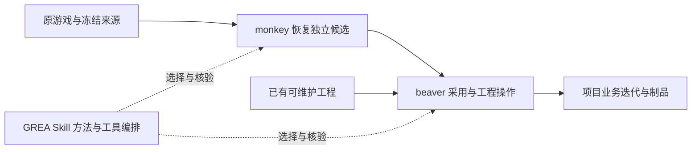

# GREA、monkey 与 beaver：游戏恢复与开发架构 v2

2026-10-26。用户批准的三产品结构取代本文件 v1“两执行产品、六模块全部留 GREA”的建议。本文为架构与归属说明；实现进度以[生命周期路线](lifecycle-roadmap.md)为唯一入口。底层路径/CLI/Skill ID 保持兼容。

## 产品与阶段

| 所有者 | 负责 | 不代替 |
| --- | --- | --- |
| GREA | Skill、规范、阶段决策、发现与身份绑定、薄调用和结果组织 | 解析器、第二套工程执行器、游戏业务 |
| monkey | 原包识别/恢复、源资源配置代码依据、独立原生候选、来源身份和转换诊断 | 修改当前开发工程、业务实现、产品构建发布 |
| beaver | Unity工程采用/迁移、框架/Prefab/UI、图片/JSON/C#、通用Go工程/模块/协议和构建交付工具 | 原包解析、产品设计、未知规则补猜、正式游戏服务业务 |
| 游戏开发者 | 本项目业务、UI 接线、服务器与存档、实际版本可玩和交付 | 用工具 pass 代替产品验收 |

原先列出的六类下游能力按模块归 beaver，不各拆产品。GREA Skill 贯穿调研→恢复→接手→开发/换皮→验收→构建/上线方法，不成为额外审批层。

## 工程工具的模块划分

beaver 是统一的工程工具产品，内部保持模块边界，共用项目身份、操作计划、日志、产物清单和恢复事务；各模块可以独立调用，不要求每次执行整条流水线。以下是职责设计，具体可用操作以固定版本的 capability 和[接入说明](../plugin/skills/grea/references/providers/beaver.md)为准。

| 模块 | 主要输入与输出 | 责任边界 |
| --- | --- | --- |
| 工程与资产治理 | 开发工程＋候选映射 → 引用审计、迁移计划、采用/回滚记录 | 工作工程的移动、重命名和冲突处理；恢复输出的身份与引用闭包由 monkey 修复 |
| 标准工程生成 | 项目规格＋版本化模板 → 目录、程序集、框架、通用组件和 Prefab | 生成通用骨架；具体玩法、UI 接线和业务规则留项目 |
| 美术资源管线 | 已批准素材＋资源规格 → 检查、压缩、切片或替换计划 | 管理接入与可追溯变化；素材生成服务保持独立 provider |
| JSON 配置 | Schema＋正式 JSON → 校验结果、强类型代码和配置候选 | Player 实际解析 JSON；不把重复 SO 数值表变成第二维护源 |
| 回归验收 | 基线＋测试计划＋当前制品 → 分层运行记录和差异 | 工具检查、原生读回、真实输入、视觉及业务结果分别记录 |
| 构建与交付 | 固定源码/配置＋构建规格 → Player、清单、校验与交付包 | 固定制品身份；构建成功不代替游戏验收，上传发布依本次授权 |

例如，恢复旧包时由 GREA 选择 monkey，接收独立候选后让 beaver 规划采用；以后调整奖励 JSON、替换图片、回归与构建直接走 beaver。只有新的恢复输入或来源缺口需要重新进入 monkey。恢复资产错误反馈 monkey，工程迁移错误反馈 beaver，流程和验收标准问题反馈 GREA。

Go服务器是beaver0.3必选工程模块，和Unity共同形成该大版本出口；Cocos执行延后。通用六服工程/业务模块骨架、Proto与C#＋Go配置类型、受控MySQL迁移、格式/构建/测试、隔离Docker与匹配制品归beaver。GREA保留grea-server-go Skill、六服方法与薄调用；真实产品规则、唯一共享后端和持久数据由游戏项目维护。[45文件定向交接](beaver-execution-handoff.md#go服务器能力的定向交接)已被上游定向提取；固定07候选交出自有六服/Unity联调证据，GREA仅接入候选/计划等有限路由。旧Go执行链未退休，不把模板、health或工具自测说成正式项目业务采用。

## 资产治理边界

恢复候选的规范输出、来源 ID、GUID/UUID/localID、importer、原生 Prefab/Scene 和引用闭包归 monkey。工作工程的资源重命名/移动、引用修改、人工冲突、候选采用与恢复事务归 beaver。GREA 持可读结构/命名规范及选择说明，不各维护三份路径算法。

继承已确认的 monkey-project/2.0.0 类型优先结构，机器映射由 monkey 输出、beaver 核验使用。数值配置唯一维护源为运行时实际读取的 UTF-8 JSON；SO/Prefab/Scene 维护原生对象引用，不另存重复可编辑数值表。具体游戏规则、Go 六服业务与私有资源仍留项目。

## 候选到工程的接续

monkey 输出版本化 manifest/recovery-manifest，至少可定位来源/版本/输入指纹、目标和编辑器、资源身份映射、文件/meta/importer、代码依据与未知、生成/人工/第三方所有权、真实入口和各层验证状态。保留 unknown，不将数量或 completed 当原生/业务完成。

beaver 对新工程建立独立开发基线；对已有工程比较“旧候选＋新候选＋当前工程”。无共同基线、身份不明或双边改动时不猜自动覆盖。源移除只产生删除建议，不能直接删人工或仍被引用资产。新候选与原包只读。

操作计划绑定工具/项目/候选身份、允许写区、expected-before、动作/冲突策略与恢复位置。原生资源移动/保存使用引擎 API；恢复仅撤销仍匹配本次 after 状态的自有变化，不覆盖后续人工修改、玩家档或服务事实。

执行层统一保留工具版本、输入指纹、计划指纹、实际写入及 provider 原始诊断。GREA 不将 partial/blocked/not_run 提升为通过；进程退出与结果合同不一致时返回 needs_action 并保留原始结果。它不是第三套转换器或工程框架。

方法细节见[候选交接与三方合并](../plugin/skills/grea-unity-standard/references/候选交接与三方合并.md)。工程操作合同由 beaver 单写；本文不宣布未交付 API 已可用。

## 必选工具与过渡

GREA 新主线 required providers 为 monkey、beaver，缺失/不兼容/漂移明确 needs_action。恢复实际用 monkey，开发工程实际用 beaver；已有工程复用已核恢复基线，不为双调用重导。纯规划可继续。

当前已安装 GREA dev2/monkey0.4.0 保持。本地源码dev4补齐beaver0.1.0命名转发与生成Schema。beaver最终本地wheel已交付，GREA dev3的匹配源码构建/Player前后身份检查可直接复用；早期Prefab读回属于不同wheel，不混称同版全链。已有monkey候选采用预览、beaver原生样例及正式游戏采用分别记录，本轮只收口本地工具集成，不冒称肥鹅已切换。

dev4先按固定beaver0.2.0合同扩展为25个命名操作，记录见[0.2接入回执](../validation/development/beaver02-integration-20261026.json)；现另固定07（0.3.0.dev1）和08/元数据等价09（本地0.3.0），共49路由，核精确producer、组合能力及请求/结果Schema。最终45项适配检查、CLI和独立stdio通过，旧0.1/0.2/07锁实调且哈希不变；证据分层见[0.3回执](../validation/development/beaver03-integration-20261026.json)。正式项目主开发的08新计划已在中文路径完成原生收敛，GREA只读核验其producer、计划、相同C# after-image和同Editor读回，不重跑或推断完整游戏验收。0.3整版G结论由beaver主开发汇总；旧事务不换包重放，旧Go链不自动退休。

monkey0.5.0.dev1已有三类来源查询，须使用显式开发入口；当前monkey_pipeline仍固定稳定0.4合同，不为收口等待整版0.5，也不将开发能力伪装为已安装命令。

[旧实现交接材料](beaver-execution-handoff.md)先冻结代码/依赖/许可/调用者。beaver 接收并验证、消费者切换完成前，旧 GREA 工具 ID 及实现保留兼容；之后改薄路由，再退休重复实现。日常新链不能以旧兼容例外绕过必选 provider。

## 验证与实施顺序

先 Skill 与归属清单，再 beaver 只读检查/规划和可恢复工程操作，继而隔离副本的采用、原生 UI/Prefab、资源/JSON、回归与构建，最后迁消费者和退休旧实现。肥鹅为已批准试点；暂停项目仅按授权只读提供工具来源，不恢复开发。

分别记录代码/静态、provider readiness、原生连接与回读、Player/输入/视觉、产品业务、安装/发布。当前未完成三方真实链时不能合称架构已交付。本轮不新增推送、发布、全局安装或原工程修改。
