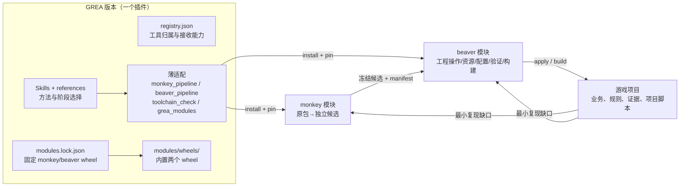

> 发布脱敏摘要：本文含原始回执的公开摘要；脱敏前原件仅保存在私有冻结目录。

# GREA＋monkey＋beaver 工具链审计与统一发布

日期：2026-10-27。范围：`projects/sample-a`、`projects/sample-b`、`tools/grea`、`tools/monkey`、`tools/beaver`。本文是审计结论与路线；已在本轮实现的部分单独标出，其余是提案。

## 1. 读取范围

- 两个游戏读取 AGENTS、README、Docs（计划、评审、协作、调试、结构、验收、交接）与 `Tools/` 全量清单；Unity 工程、原包和证据目录（约 210G / 18G）按需引用，不逐文件读取。
- 三个工具读取 AGENTS、README、版本、分支与未提交状态、registry/能力声明、来源清单（beaver `SOURCE-INVENTORY.json`）及 Manager 决定 `20261026-grea-monkey-beaver/{PLAN,CONTRACT}.md`。
- 没有启动 Unity、Player、Docker 或服务；没有写游戏项目、monkey 或 beaver。

## 2. 现状

| 产品 | 版本/分支 | 工作树 | 职责 |
| --- | --- | --- | --- |
| GREA | 2026.10.26.dev4（`codex/monkey-toolchain-v040`） | 157 项 dev4 改动未提交（技能 references 重命名、beaver 薄转发）；本轮前已快照到 `[私有本地路径已脱敏]/` | Skill、方法、发现/绑定、薄转发 |
| monkey | 稳定 0.4.0（GitHub Release）；在途 0.6.0.dev1（`codex/v0.6-csharp-recovery`） | 另一会话正在写入（C# 恢复后处理） | 原包→独立候选 |
| beaver | 0.3.0 本地交付未发布（`codex/beaver-v0.3`） | 干净；仅为[项目 A] v1.3 按需维护 | 候选/已有工程→持续开发与制品 |

两款游戏实际固定的工具版本各不相同：[项目 A] v1.1 采用 monkey 0.2.0.dev1 分发02、规范迁移固定 GREA dev2＋monkey 0.4.0＋beaver 0.3；[项目 B]固定 monkey dev2/dev3 与 GREA 2026.10.24rc1。没有一份“这一版 GREA 配哪一版 monkey/beaver”的单一声明。

## 3. 发现

| # | 发现 | 依据 | 处理 |
| --- | --- | --- | --- |
| F1 | 没有统一发布。GREA 插件只带自身；monkey 走自己的 Release，beaver 只有本地 wheel；项目各自固定不同组合 | 上表；GREA `plugin/version.json` 只有 `requiredProviders` 名称 | **本轮实现**：`modules.lock.json`＋构建内置 wheel＋`grea_modules`（第 5 节） |
| F2 | GREA 仍保留 35 个应移交的执行工具，其中 18 个接收方尚无对应能力 | `registry.json` ownership | **本轮实现**：每项登记 `receiver.capability/status`；缺口清单见第 6 节 |
| F3 | 项目脚本复制膨胀：[项目 A]约 340 个工具，`build_native_mainline_52…74` 与 `launch_native_mainline_52…73` 按编号复制；[项目 B] `run_editor_window02…04` 等重试副本；Wasm 索引/配置解码等通用能力写在项目内 | 两项目 `Tools/` 清单；[项目 A] REVIEW-20261022 D6 | **本轮实现**：新 reference《项目脚本沉淀与工具晋升》；接收清单见 [交接包](triad-intake-from-projects-20261027.md) |
| F4 | 关键经验只在项目文档：CUA 同帧拖拽、Editor 退出落盘、MoveAsset 改主对象名、Player 后台暂停、Metal 呈现、provider 超时、复合查找键、配置版本不随内容变、每步同步锁输入、宿主上千行、立项前提（授权/平台）、进度度量失真、流程开销 | [项目 A] REVIEW/AGENT-COLLABORATION/PROJECT-STRUCTURE/PLAN；beaver PLAN；[项目 B] PLAN | **本轮实现**：分别写入对应权威 reference（第 4 节） |
| F5 | GREA 薄适配硬编码 beaver/monkey 版本表，模块升级必须改 GREA 源码，且没有门禁保证锁与适配器一致 | `integrations/beaver.py` `V03_CANDIDATES`；`monkey/pipeline.py` `SUPPORTED_VERSIONS` | **本轮实现**：保持适配器显式，测试把锁作为发布门禁（锁里的版本/实现哈希必须被适配器支持） |
| F6 | monkey 仍保留 `adoption.py`/`adoption_native.py` 工程采用实现，与 beaver `adoption.*` 重叠 | beaver SOURCE-INVENTORY `extract-frozen-working-project-transaction` | 提案：消费者切到 beaver 后由 monkey 主开发退役（不在本轮改 monkey） |
| F7 | GREA 自带 Unity 框架模板、五层生成器、Go 模板，与 beaver `csharp.module`、`server.generate` 重叠 | `tools/unity/framework`、`tools/server-go/template`、beaver 0.3 能力 | 提案：GREA 保留规范与样例说明，执行入口转 beaver；旧 ID 在接收验收前保留 |
| F8 | 并发写入风险：GREA dev4 未提交、monkey 正被另一会话写入 | git status、mtime | 本轮只写 GREA；GREA 改动前快照；monkey/beaver 只出交接包 |

## 4. 已沉淀到 GREA 技能的经验

| 经验 | 写入位置 |
| --- | --- |
| 自动化输入同帧压缩、`InputTestFixture` 跨帧测试、验收输入适配的隔离、真人短试玩 | grea-parity《Unity界面还原与输入交互》§自动化输入与跨帧验收 |
| Editor 退出落盘、Licensing 中断、MoveAsset 改名、Player 后台、Metal 呈现、provider 超时、单 Editor 占用、专用小窗与复用构建 | grea-delivery《Unity编辑器连接与任务执行》§原生执行常见陷阱 |
| 主宿主/教学宿主/命令分发/配置/Prefab 的注册化拆分与退出条件 | grea-unity-standard《Unity程序集分层与生命周期》§宿主拆分与模块注册 |
| 立项前提（授权、平台）、最小闭环、真实进度度量、流程开销与工作树上限 | GREA《开发计划与进度管理》§立项前提与进度度量 |
| 配置内容哈希版本、存档迁移链、客户端本地模拟＋批量提交、六服逻辑边界与部署形态 | grea-server-go《Go六服与事务》 |
| 复合查找键、坐标换算依据、大表机制覆盖＋抽样 | grea-parity《规则与随机一致性》§6A |
| 上述症状的排查入口 | GREA《故障排查与重试规则》 |
| 项目脚本→参数化/交接/留项目的判断与接收方 | GREA《项目脚本沉淀与工具晋升》（新） |
| 模块统一发布与安装 | GREA《monkey与beaver调用》§模块统一发布与安装 |

已有且未重复写入：全量初版先行（[项目 B]纠正）、研发交接资料核验（[项目 B]同事包）、候选交接与三方合并、Unity 重构与资源迁移（[项目 A]规范迁移）。

## 5. 目标架构与统一发布

- **独立开发、统一发布**：monkey 与 beaver 保留各自仓库、版本、CLI 和主开发；GREA 版本通过 `modules.lock.json` 固定两者 wheel（文件名、SHA256、字节、依赖、来源）。带 tag 的完整插件构建必须 `--modules DIR` 内置两个 wheel，否则拒绝；预览构建记为 `not_bundled_preview`。
- **共享运行时**：模块依赖（Pillow、pypinyin）进入 GREA 锁定运行时（`modules` extra）；模块安装为独立版本化 venv，通过一行 `.pth` 使用 GREA 运行时依赖，不与核心互相 import。
- **显式安装与就绪**：`grea_modules status` 只读；`install` 校验锁与 RECORD 后安装，不下载、不改已有 binding、不全局安装。安装后的启动器只是发现候选，仍经 `beaver_pipeline pin`、`monkey_pipeline ensure`、`toolchain_check` 判定就绪。
- **发布门禁**：测试要求锁中模块版本（及 beaver 实现哈希）被 GREA 适配器支持；模块升级 = 模块发版 → GREA 更新锁与适配器 → 测试 → 随 GREA 新版发布。在途项目旧 lock 不自动切换。

本轮实测（隔离状态目录，未动真实 provider 绑定）：两个真实 wheel（monkey 0.4.0 `ec5a4b16…`、beaver 0.3.0 `d4dd7229…`）安装成功，monkey `--version` 与 capabilities、beaver `version`（实现 `e6191235…`）正常；beaver 经现有 pin 得到锁，monkey 经现有 ensure 绑定，`toolchain_check` 为 `ok/ready`。证据：[grea-modules-20261027](../validation/development/grea-modules-20261027.json)。

## 6. GREA 执行工具接收图

`registry.json` 每个移交工具的 `ownership.receiver`：

- **已有接收能力（17，等价性待接收方验证）**：unity_asset_ledger、unity_dependency_audit、unity_reference → beaver `references`/`unity.assets.move`；verify_payload_tree、static_asset_copy → `payload.*`；image_alpha_audit → `image.inspect`；unity_pilot → `project.inspect`/`workspace.inspect`；unity_config_candidate、config_preflight → `config*`；unity_native_assets、theme_assets → `resource.*`/`production.*`；server_go_project → `server.*`；compatibility_plan、operations_preview → `batch.plan`/`production.plan`；cocos_assets、cocos_modules、cocos_convert → monkey `convert`。
- **缺口（18）**：beaver——compare_events、compare_traces、presentation_audit、performance_compare、video_manifest、video_sheet、image_contact_sheet、audit_numeric_texture、evidence_manifest、unity_native_exit、unity_player_audit、unity_package_backup、package_windows_portable、cocos_project（Cocos 暂停）；monkey——laya_contract_audit、read_elf_values、unpack_xapk、shader_probe。

退役规则不变：接收方冻结源、参数化、隔离验证→消费者切换→GREA 旧 ID 变薄转发→最后退役；之前不删除、不空成功。

## 7. 路线

| 阶段 | 内容 | 负责 | 出口 |
| --- | --- | --- | --- |
| R1（本轮完成） | 模块锁/内置/安装、接收图、经验沉淀、晋升方法 | GREA | 测试与隔离实装通过；未提交、未发布 |
| R2 | beaver 接收“已有能力”的 17 项等价性对照；GREA 对应 ID 转薄转发 | beaver 主开发 → GREA | 每项有固定输入的前后结果对照 |
| R3 | beaver 补 14 项缺口中项目真实需要的部分（优先 evidence/presentation/performance/player_audit）；monkey 收 4 项来源工具与[项目 B] Wasm/配置解码族 | beaver、monkey 主开发 | 能力进 capabilities；项目消费者切换 |
| R4 | monkey 0.6 发版后更新锁；首个“GREA＋两模块”统一 Release（双平台完整插件内置 wheel） | GREA（发布需用户授权） | 完整插件构建、隔离安装与客户端验收 |
| 持续 | 项目按晋升方法收敛编号脚本；monkey 退役 `adoption*` 重叠实现 | 游戏主开发、monkey | 编号副本不再新增 |

## 8. 本轮未做

- 没有提交或推送任何仓库，没有发布 Release，没有改真实 provider 绑定或全局安装。
- 没有写 monkey（另一会话正在写入）与 beaver 源码；接收工作以交接包形式提供。
- 没有构建完整插件归档（需下载运行时并要求干净树或 `--worktree` 预览）；构建脚本改动由单元测试和真实 wheel 安装覆盖。
- Windows 模块安装显式返回 needs_action（现有 provider 就绪只认 POSIX 启动器）。
