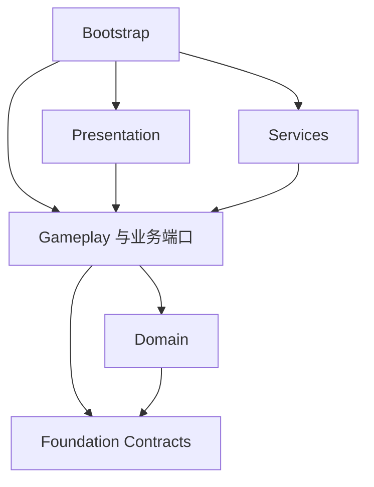

# Unity 工程标准 v1

规范标识：`grea-unity-project`；规范版本：`1.0.0`；制定日期：2026-10-13。本文是 grea 恢复工程的目录、开发框架、组件、Prefab、脚本与生成验收的权威设计；保留原文件路径及目录分类锚点。

**状态：规范设计已落盘，配套框架包、Prefab 库、工程生成器和专项校验器尚未实现。** 现有 grea 资产台账、依赖审计和 CLI/MCP 仍按当前契约使用。本文出现的包名、类型名、配置字段与新操作名均为设计约定，不代表已安装、已注册或已验证能力。实施顺序、当前进度与交付门槛见 [落地计划](../../docs/11-Unity工程标准落地计划.md)。

按需阅读：[范围与版本](#规范范围与版本)、[目录](#工作区与项目边界)、[资产类型](#类型归类表)、[框架](#开发框架与依赖方向)、[生命周期](#生命周期与数据契约)、[组件](#通用组件)、[Prefab](#通用-prefab)、[脚本](#通用脚本与生成所有权)、[生成](#自动生成契约)、[资源寻址](#动态加载与路径)、[验收](#验收规则)、[升级](#升级与例外)。

## 规范范围与版本

- **必须**：采用本标准的范围必须满足的正确性、身份与可恢复要求；未满足时不能声明该范围符合标准。
- **默认**：新建且选择本标准的恢复工程采用的结构；已有工程可以通过明确例外沿用现状。不能为目录一致而改变玩法、随机、更新顺序、存档或序列化身份。
- **可选**：只有项目有实际需求时引入；未启用的模块不创建空目录、空组件或占位服务。

适用于新增恢复工程、跨引擎恢复和获准的既有工程重构。原创游戏不因本标准扩大 grea 的适用范围。采用标准、安装包、生成资产、迁移工程和发布游戏是不同的任务范围；遵循当前用户授权，已有明确授权不重复要求批准。**本次仅制定规范与计划，不修改任何既有游戏工程。**

目录与组件约定由本文维护；原版取证见 [恢复顺序](3-开发顺序与复用.md)，资产迁移与行为冻结见 [资产治理](17-Unity工程重构与资产治理.md)，UI 框架替换见 [UI 迁移](18-原生UI迁移与旧框架退役.md)，构建和发布只服从 [构建规范](23-构建输出与版本发布.md)。不得另建竞争的构建目录、存档规则或项目状态入口。

### 版本与适用配置

标准版本、框架包版本、模板版本、生成器版本和游戏发布版本分别锁定。标准的破坏性契约修改升主版本；兼容新增升次版本；不改语义的修正升补丁版本。项目升级必须选择目标版本及迁移说明，不随 grea 更新自动升级所有项目。

未来项目根的 `grea-project.json` 保存机器可读选择；项目 `Docs/PROJECT-STRUCTURE.md` 解释实际所有权与例外，引用该配置，不能再手工维护另一套版本值。配置 schema 由实施阶段定义，本轮不添加可执行 schema 或虚构能力注册。

| 字段组 | 必填内容及约束 |
| --- | --- |
| 身份 | schemaVersion、standardVersion、projectId、合法 C# namespace；不从产品显示名推断稳定身份 |
| 路径 | unityProject、evidenceRoot、buildRoot，均相对项目根；允许既有布局的显式映射；解析后不得越出获准范围 |
| 工具链 | Unity 精确编辑器版本、渲染管线及包版本、UI 方案、输入方案、目标平台/架构/后端 |
| 依赖 | manifest 与 packages-lock 指纹；启用框架包的版本、来源及内容指纹；不含凭据或本机绝对路径 |
| 模块 | 已启用的基础能力与业务模块、场景入口、资源寻址方案、存档适配器、QA 隔离方式 |
| 生成 | templateVersion、generatorVersion、模块清单、生成物归属；执行后关联实际生成清单 |
| 例外 | ruleId、scope、reason、替代约束、验证方法、owner、reviewTrigger；采用前由项目维护者确认 |

先验证所选组合是否在能力矩阵中。能力矩阵至少区分“未实现、已生成、Editor 编译通过、PlayMode 通过、目标 Player 通过”，附实际版本和证据。首个参考组合拟选 Unity 6、2D、URP、uGUI、macOS；精确编辑器与包版本在实施启动时锁定。此选择不是已经支持整个 Unity 6 系列，也不要求已有工程迁移 UI 或渲染管线。

## 工作区与项目边界

### 标准工程目录与真实类型归类

以下为允许的结构，不是必须一次性建立的空目录清单。项目编号由使用者所在工作区分配，不由生成器猜测或覆盖已有工程。

```text
<项目根>/
  grea-project.json                 # 未来机器可读配置；本轮仅定义契约
  <游戏工程名>/                    # 既有工程名沿用
    Assets/
      Game/
        Runtime/
          Bootstrap/               # 应用入口、依赖装配与顶层作用域
          Domain/<模块>/           # 状态、规则与业务不变量
          Gameplay/<模块>/         # 用例、会话流程、业务端口
          Presentation/<模块>/     # UI、场景视图、输入表现和动画桥接
          Services/<能力>/         # 平台、存档、资源等端口实现
          Diagnostics/             # 项目状态快照与诊断适配
        Content/
          Prefabs/<模块>/          # 需要生成时再分 Generated、Variants
          Config/<模块>/           # 配置资产与运行数据分离
          Levels/<模块>/
          Materials/ Shaders/ Images/ Sprites/ Models/
          Animations/ Spine/ Fonts/ Audio/
        Scenes/                    # 最小入口与实际启用的内容场景
        Editor/
          Generators/ Validators/ Build/
        Tests/
          EditMode/ PlayMode/
      ThirdParty/                  # 必须留在 Assets 的供应方资源
      Plugins/                     # 存在平台插件时使用 Unity 导入约定
    Packages/                      # manifest、lock；按需嵌入已锁定包
    ProjectSettings/
  Docs/                            # 结构说明、计划、验收及项目例外
  Tools/                           # 项目专用转换与维护工具
  Art/                             # 制作源、批准设计、制作记录
  Analysis/ Evidence/              # 原始提取、分析、行为/视觉证据
  Build/                           # 严格沿用构建规范
```

**STR-01 所有权**：Game 只保存该项目的运行与编辑必需内容。第三方代码、通用框架和项目业务分别维护；不能把原导出树换一个 Recovered/Original 名称后直接当成标准化结果。原始导出完整保留在 Analysis，只读证据不进入生成覆盖范围。

**STR-02 职责唯一**：新内容统一用 Game/Editor，不另建第二个日常 Editor 入口。UI 代码归 Presentation 下实际模块；输入设备实现归 Services/Input，输入到业务命令的转换归 Presentation。配置数据归 Content/Config，解析/校验代码归消费它的模块；不再并列含义重叠的 Runtime/UI、Runtime/Config、Runtime/Levels。已有路径可登记例外，不能自动迁移。

**STR-03 身份与纳管**：Assets 中维护的文件及目录保留相应 .meta，Packages 的 manifest/lock 与 ProjectSettings 按项目 Git 规则纳管；Library、Temp、Logs、obj、UserSettings、构建制品、原始证据和运行存档不进入源码提交。具体证据托管按项目约定。代码移动、程序集改名和命名空间修改分别分析 MonoScript、反射与序列化影响，不因路径变化自动同时执行。

**STR-04 自包含**：通用代码以锁定包接入；项目专用工具留项目。禁止通过指向维护者 grea 检出的符号链接才能编译。首次落地默认提供嵌入包分发，保持项目可独立恢复；未来采用 Git/包注册表时固定不可变版本或提交及内容身份，凭据由环境提供。一个包只能安装一份；升级是显式变更。

### 通用包的维护位置

未来自有框架源码在 grea 的 `tools/unity/framework/packages/` 按实际交付建立，模板放 `tools/unity/templates/`；本轮不创建这些占位目录。建议先有基础包，再按实际依赖引入 uGUI 和 Editor 生成包，不先拆大量微包。

| 候选包 | 内容和依赖边界 |
| --- | --- |
| com.grea.foundation | 纯契约与最小生命周期/诊断实现；不包含项目玩法、UI 技术栈或商业服务 |
| com.grea.ui.ugui | 可选 uGUI 视图组件和无项目素材的基础 Prefab；显式依赖 foundation 与锁定 UI 包 |
| com.grea.authoring | Editor 内的生成、绑定与校验；不进入 Player，不携带原包或业务适配器 |

包内按实际内容建立 Runtime、Editor、Tests、Samples~、Documentation~，附 package.json、许可证和依赖范围。包目录规则参考 [Unity Package layout](https://docs.unity3d.com/6000.0/Documentation/Manual/cus-layout.html)。项目修改放自身扩展/Variant；不能直接修改 PackageCache，也不靠复制第二份同 GUID 资产来定制。

## 类型归类表

| 内容目录 | 实际归属 |
| --- | --- |
| Prefabs | GameObject Prefab；可按 UI、角色、方块、特效分子目录 |
| Materials / Shaders | Material；Shader/HLSL/include 等实现，不能因名字含 Spine 就把 Shader 当骨骼数据 |
| Images / Sprites | Texture2D 原图、贴图；独立序列化 Sprite。一个纹理内的 Sprite 子资源不拆成重复图片 |
| Models | Mesh、导入模型及必要模型组；动画子资源随宿主文件保留 |
| Animations | AnimationClip、AnimatorController、Avatar；按类型或使用者分组 |
| Spine | 按动画组聚合骨骼、Atlas、页纹理、材质和 SkeletonData；记录运行时版本 |
| Fonts | 字体源、TMP/位图字体资产及配套材质/图集；不把所有 .asset 当配置 |
| Audio | 音乐和音效；播放键与音频来源单独登记 |
| Config | ScriptableObject、JSON、输入动作等配置 |
| Levels | 关卡数据及索引；保留文件号、显示关号、循环规则之间的映射 |

使用 Unity 实际导入类型、主/子资源和依赖判断。无法加载的 .asset 先查源 MonoScript 和序列化字段，记录推断类型与未修复状态；不能统一放入 MonoBehaviour，也不能为了分类删掉缺脚本资产。

活动工程按类型组织。来源身份、旧路径、GUID、原包/版本写在迁移清单；确需区分来源和编辑副本时，使用类型内的 `Source/Working` 或 `Templates/Views`，不恢复 `_Game/Falcon/GameTemplate/...` 的完整来源树。原始导出工程仍可完整保留在 Analysis，作为只读证据。

脚本按已存在的职责归组；同一 partial 类放在同一职责目录。Runtime、Editor、Tests 的目录名不自动建立编译隔离，需核对 asmdef、条件编译、反射与构建入口。生成工具、校验、构建分别命名，旧重生成器在新布局中应明确停用或迁移调用方。


## 开发框架与依赖方向

**ARC-01 默认分层**：以业务所有权划分模块，同一模块跨 Domain、Gameplay、Presentation 时沿用同一模块名。小模块可在同一层程序集内分目录，不为每个类建立接口或程序集；纯规则层和 Editor/测试隔离仍须成立。

| 程序集设计名 | 所有者职责 | 允许的直接依赖 |
| --- | --- | --- |
| Grea.Foundation.Contracts | 通用接口、结果、标识；无 Unity 类型 | System 与明确锁定的纯托管依赖 |
| Grea.Foundation.Runtime | Unity 生命周期适配与诊断实现 | Contracts、Unity Runtime |
| Game.Domain | 业务状态、规则、计算；不负责播放或持久化 | System；按需使用纯 Contracts |
| Game.Gameplay | 用例与会话编排、业务端口、事务结果 | Domain、纯 Contracts |
| Game.Services | 存档/资源/设备/平台的具体适配 | Gameplay 的端口、Domain 数据、基础包和相应 SDK |
| Game.Presentation | 输入到请求、状态到视图、动画桥接 | Gameplay、Domain 的只读数据、基础包及选定 UI 包 |
| Game.Diagnostics | 项目专用快照与诊断订阅 | 公开只读契约、基础诊断能力；不反向驱动玩法 |
| Game.Bootstrap | 创建并组合上述实现 | 需要装配的各运行程序集；其他业务层不得引用它 |
| Game.Editor / 测试程序集 | 生成、校验、构建；编辑态或运行态测试 | 被检查/测试的运行程序集；运行代码不得反向引用 |

图中的箭头表示静态引用方向；外部服务实现由 Bootstrap 注入 Gameplay 声明的端口，Gameplay 不引用 Services 的具体实现。



图省略了表中允许的其余引用，表为完整规则。`Game` 是示例命名空间前缀，应替换为项目配置值。公共包不得反向引用 Game；模块互相通过明确端口或只读结果协作，出现循环依赖先重新划分所有权，不能用全局服务定位器绕过依赖检查。

**ARC-02 编译隔离**：使用 asmdef 实施边界。Domain、Gameplay、Contracts 默认 noEngineReferences；Editor 仅在 Editor 平台编译；测试单独程序集且只在测试构建启用。只建立目录不算完成隔离；反射、预编译 DLL 与代码生成也要进入依赖审查。Unity 包的 Runtime/Editor/测试程序集应显式引用依赖，见 [官方程序集说明](https://docs.unity.com/en-us/engine/6000.0/manual/packages-list/cus-pkg-development/cus-asmdef)。

**ARC-03 接入策略**：v1 默认显式构造函数/初始化参数装配，不强制额外 DI 容器、ECS、响应式库或消息总线。已有框架按获准范围适配；小修复不顺带替换。确需第三方框架时记录版本、许可证、AOT/IL2CPP 与目标平台验证，避免同一工程并存多套初始化和资源生命周期。

### 场景与启动契约

默认使用配置声明的 Bootstrap 入口创建应用作用域，再加载实际内容场景；入口场景名称、加载方式和 build 场景清单由项目配置锁定，不靠数组下标或全场搜索推断。持久服务与内容场景对象有明确所有者，切场景不重复创建音频、输入或资源服务。

单独打开内容场景的 Editor 预览必须显式提供预览装配和隔离存档，不能偷偷生成生产全局对象；普通 Player 只沿正式启动链。原工程已有启动场景或固定加载顺序时先登记并适配，不能为了模板改写原初始化时序。

## 生命周期与数据契约

**LIF-01 作用域**：应用作用域拥有共享服务；会话/关卡作用域拥有玩法状态与任务；界面作用域拥有绑定与表现任务。创建者明确持有并释放资源，子作用域不得长于父作用域。跨作用域借用不得冒充所有权。

| 对象 | 状态及进入条件 | 退出与失败处理 |
| --- | --- | --- |
| 应用服务 | Created → Initializing → Ready | Stopping → Stopped；初始化失败进入 Faulted，并逆序释放已成功初始化项 |
| 玩法会话 | Created → Loading → Running；需要暂停时进入 Paused | 退出先阻止新命令，再取消待执行任务、清理表现并按项目事务规则结束 |
| 界面 | Unbound → Bound → Visible → Hidden → Unbound | 关闭清理本次显示订阅/任务；复用前复位；销毁后旧回调不能再写视图 |
| 池化实例 | Available → Rented → Returning → Available | 租约只允许归还一次；宿主退出清理活跃项，超额/失效对象执行明确销毁策略 |

状态名称是框架语义，不强制替换原游戏已有状态值。Bind/Unbind 与 Show/Hide 的责任必须分开；重复初始化/重复关闭应无副作用或返回明确状态错误，不能重复注册监听、创建服务或结算。Awake/OnEnable 只做局部初始化或绑定；跨模块的顺序由 Bootstrap/会话编排决定，不能依赖未声明的脚本执行顺序。

**LIF-02 取消与回调**：每项异步操作关联 operationId 和所属作用域；界面关闭、换关、对象归还、应用退出均有对应取消策略。晚到结果检查作用域代次与对象有效性；取消不等于成功，不触发完成奖励。业务提交点之前可取消，提交后按幂等结果处理；跨服务事务失败的补偿规则由 Gameplay 定义。动画事件驱动的完成不能被任意固定延迟替换。

**LIF-03 时间与随机**：区分玩法时钟、表现时钟与真实时间；暂停和后台策略显式配置。恢复工程保留原共享 RNG 的状态、调用顺序和消费关系；表现随机仅在不改变原语义时隔离。可注入时钟/RNG用于测试，但生产路径不能偷偷切换种子或时基。

**LIF-04 编辑器重入**：记录进入 Play 的 Domain Reload/Scene Reload 配置；静态缓存、单例持有和事件订阅必须在所选配置下可重置。重复进入/退出 Play、同进程再开一局与真正关闭 Player 后重开分别测试。不能把测试进程重启清空静态状态当作生命周期清理正确的证明。

**DAT-01 数据种类**：配置资产（ScriptableObject/JSON）、可变运行状态、持久化 DTO、UI 视图数据分别定义。配置不保存玩家运行进度；退出 Play 后不能把测试状态写回配置资产。数据必须有唯一写入所有者；View 发出请求，Gameplay 调用规则并提交状态，视图根据结果刷新。

**DAT-02 存档**：定义 schemaVersion、迁移器、备份/恢复与校验失败策略；先写独立临时内容再按目标平台支持的方式提交，验证异常中断恢复。QA 使用独立 save namespace。已有恢复工程通过适配器保留旧存档键、编码和原子性语义，不能因为统一 DTO 自动改写玩家存档；迁移另行确认范围并验证关闭重开。

**DAT-03 输入和事件**：输入设备事件先转成明确业务命令，包含执行者和必要上下文。模块内优先直接调用/类型化订阅；跨模块事件说明发送者、订阅者、顺序、线程、重复与取消语义。禁止 View 在多个回调分支重复扣费、保存或发奖；不要用无边界全局事件总线隐藏控制流。

## 通用组件

以下是 v1 候选能力及准入契约，尚无可直接安装的实现。首批只实现参考闭环需要的能力；其余保持计划项，不生成同名空类。

| 能力与候选类型 | 输入/所有权 | 输出、故障与最低验收 |
| --- | --- | --- |
| 作用域与生命周期（AppScope、SessionScope） | 父作用域、显式依赖、初始化顺序 | Ready/失败状态；重复启动不增实例；失败逆序清理；退出无活跃子任务 |
| 页面与弹窗（ScreenHost、ModalHost） | 视图工厂、作用域、导航/遮罩策略 | 打开/关闭结果；重入、排队/替换策略显式；关闭后不接收旧响应；焦点正确恢复 |
| 交互反馈（ButtonFeedback） | 按下/释放/禁用状态与反馈配置 | 只负责表现；重复绑定一次输入只发一次请求；拖出、取消、失焦不伪造点击 |
| 列表与复用（ItemView、PoolLease） | 展示数据、租约、回收回调 | 无旧文本、旧图片或残留订阅；快速滚动/异步图片晚到不污染新数据；重复归还被识别 |
| 音频（AudioHandle、音频端口适配器） | clip/key、分组、作用域、暂停策略 | 可停止句柄；切关、静音、失焦/恢复按配置；无悬挂播放，不直接奖励或改状态 |
| 资源（AssetHandle、ViewFactory） | 稳定 key、类型、加载后端、调用作用域 | 明确未找到/类型错/已取消；共享引用计数与释放责任可追踪；业务不硬编码提供方路径 |
| 存档（SaveStore 端口与适配器） | schema、slot、QA namespace、领域快照 | 保存/加载/迁移结果；损坏和断电分支；业务存档语义保持；不把默认值静默覆盖旧档 |
| 诊断（DiagnosticSink、StateSnapshot） | 模块、操作身份、结构化事件 | 有界日志与可导出快照；关键信息包含 buildId、场景/会话、模块、operationId、资源 key；默认脱敏 |
| 输入/平台适配 | 选定设备、平台能力与授权 | 原生能力与离线替身分开；缺能力给原因，不伪造广告、支付、排行榜成功 |

**CMP-01 组件准入**：每个组件具备职责、前提、依赖、序列化字段、生命周期、错误契约、测试、最小示例和许可证。跨项目复用至少经过两个不同结构的隔离输入/示例验证；只有一处业务实现时保留候选状态。组件名称相同不代表行为契约相同。

**CMP-02 可替换性**：通用契约不携带某游戏关卡/技能/货币常量，也不依赖项目目录、固定场景对象名或 Find 全场搜索。缺少必需依赖在初始化/验证阶段报出具体字段与对象；不创建隐式全局默认实例掩盖装配错误。

**CMP-03 诊断预算**：开发日志记录事件顺序、失败点和状态摘要；生产默认关闭高频明细。每类日志/快照定义条数、字节上限与采样策略；不能无限增长或附带账号、完整存档和资源原文。重复错误聚合保留首次原因和次数。性能预算由项目的设备、场景和基线确定，不给所有项目编造统一帧率或内存承诺。

## 通用 Prefab

**PFB-01 归属**：包内基础 Prefab 仅使用自有/可分发内容；项目 Variant 和业务 Prefab 位于 Content/Prefabs/<模块>。原包 Prefab/跨引擎源对象树优先保留并适配，不能强制换成通用壳后声称原版一致。组件复用不授权公开原游戏素材。

| 候选基础 Prefab | 节点/组件契约 | 定制入口与必验项 |
| --- | --- | --- |
| UIHost（仅 uGUI 配置） | Canvas、缩放/安全区入口、页面层、弹窗层、提示层；EventSystem 由场景契约统一拥有 | 层级与排序可配置；不重复生成 EventSystem；无效分辨率/安全区提示明确；UI Toolkit 项目不生成它 |
| ModalShell | Root、交互遮罩、内容插槽、可选标题/关闭入口；引用通过序列化绑定 | 内容通过 Variant/组合提供；多弹窗输入阻断、返回键、重复打开与退出取消按契约 |
| ButtonShell | 可交互组件、视觉状态、可选音效/图标/文字槽位 | 反馈与业务回调分离；禁用、按下拖出、键盘/手柄导航按启用平台验证 |
| ListItemShell | 数据绑定组件、内容槽位、租约清理入口 | 刷新前清理前次数据；复用/异步加载/尺寸变化后无旧引用 |
| LoadingOverlay / ToastView | 内容与生命周期适配，不持有业务会话 | 超时/取消/异常后可退出；提示不消费玩法输入，除非显式配置 |

**PFB-02 绑定契约**：记录 prefabId、contractVersion、组件类型、必需字段、稳定节点标识、可选插槽、依赖、层/排序、激活状态、绑定阶段和允许覆盖项。显示名与业务 key 分开；节点重命名不应靠字符串路径悄悄改变绑定。校验器需定位 Prefab、组件、字段与预期类型。

**PFB-03 变体与生成**：基础生成资产和人工修改分离；有需要时用 Generated 与 Variants 子目录。生成器只更新自己拥有的字段/文件；没有字段级所有权实现时，整个被人工改动的资产均视为冲突。根/插槽结构变更必须检查所有受影响 Variant。Unity Variant 继承基础资产并保存覆盖，但不保证任意基础结构变更都安全，见 [官方 Prefab Variants](https://docs.unity3d.com/6000.0/Documentation/Manual/PrefabVariants.html)。

**PFB-04 引用与验收**：通过 Editor 的 AssetDatabase/PrefabUtility 创建、移动与绑定，保留 .meta、GUID 和需要稳定的局部 fileID。不能在活工程外部拼 YAML 或手写随机 GUID 来修复引用。必须验证 Missing Script、空引用、材质/字体/图集、Canvas/Camera/排序，以及实例化→显示→关闭→再次显示→销毁的真实生命周期；静态合法不代表最终画面正确。

## 通用脚本与生成所有权

**SCR-01 脚本角色**：按职责命名，例如 Session、Controller、Presenter、View、Config、Adapter、Validator；名称只作导航，不能用后缀证明分层完成。MonoBehaviour 类型与脚本文件名匹配；命名空间由项目前缀＋层＋模块组成。接口只在替换实现、隔离边界或测试替身确有价值时建立。

| 种类 | 维护者 | 更新方式 |
| --- | --- | --- |
| 框架包实现 | grea 框架维护者 | 锁定版本升级；项目不直接改安装副本 |
| 模块初始骨架 | 生成器首次创建，随后项目维护者接管 | 清单标记 seed-once；再次生成只能提出迁移建议，不能覆盖 |
| 可再生代码（明确 .g.cs） | 生成器 | 标明生成器/模板版本及所有权；输入未变时内容与 GUID 不变 |
| 人工实现与项目适配器 | 项目维护者 | 不进入再生成写入范围；通过接口、partial 扩展点或组合接入 |
| Editor 校验/构建脚本 | 包或项目对应所有者 | 与 Runtime 编译隔离；构建不能隐式执行生成 |

partial 只用于明确的生成/人工接缝，同一类放同一职责范围；不能把共享全局状态拆成多个 partial 后宣称模块已解耦。类型/字段/程序集迁移须分析 Unity 序列化与反射，按目标版本采用适当迁移方案并在 Editor 回读，不只靠编译。

**SCR-02 执行规则**：Unity API 调用遵循主线程约束；异步任务可观察、可取消，事件订阅成对清理。避免在普通 Update 中做磁盘读写、全场查找或无界分配；是否缓存/池化依实际生命周期与测量决定。UnityEngine.Object 使用 Unity 对象有效性语义，不把已销毁对象的托管包装当有效资源。

**SCR-03 数据与失败**：配置参数集中定义并校验，禁止散落业务魔法值和硬编码资产绝对路径。必需绑定失败返回结构化错误；不要 catch 后静默继续进入“成功”。诊断携带源模块/对象/字段和上下文，不输出凭据和完整用户数据。反射、字符串类型名、原生插件和 IL2CPP/AOT 裁剪路径需列入构建验收。

## 自动生成契约

本节是待实现设计。**当前 CLI/MCP 没有本节所列工程生成操作；不得直接调用猜测的 ID，或将文档示例记为执行成功。** 后续实现必须按 [统一接口](../../docs/2-接口与证据契约.md) 更新 contracts.py、registry.json、schema 和 CLI/MCP 同源分发。

### 输入与操作边界

| 拟议操作 | 输入 | 输出和写入范围 |
| --- | --- | --- |
| plan_unity_project | 项目根、配置文件、new/adopt/refactor 模式、模块范围、比较基线 | 只读盘点与 plan.json：创建/移动/修改/冲突清单、前置条件、预期验证；不打开或修改工程 |
| generate_unity_project | 已核对 plan 身份、当前授权写入范围、新 run_dir | 在限定范围执行已支持的计划，生成清单与逐步回执；不隐式扩展安装、平台、游戏迁移范围 |
| validate_unity_project | 项目根、配置、静态/Editor/PlayMode/Player 层级及本次范围 | 分层 findings 与证据；默认报告问题，不自动修复；需运行的层级使用明确目标和前提 |

static 层只读源码；Editor/PlayMode/Player 层会导入、产生缓存/日志或使用隔离 QA 存储，应在执行契约声明这些副作用。使用隔离验证副本或已获准的目标，核对验证前后 Assets/ProjectSettings 指纹；发现隐式修改时单列报告，不称作纯只读检查。

上述为拟议 MCP snake_case 名称；若获准实现，CLI 使用对应 kebab-case。name 只有在实现、schema、错误契约与测试齐备后才可注册；不提前暴露不可执行的占位工具。

new 只允许空的新工程目标，不能覆盖已存在 Unity 工程；adopt 只盘点现状、配置和例外，默认不改资产；refactor 必须有获准的模块范围及行为基线，不能把整理文件自动扩大为 UI/存档/框架替换。调用方已有明确授权时直接在该范围执行，不为每个文件增加人工批准步骤。

### 计划和生成清单

**GEN-01 可追溯输入**：计划包含 schemaVersion、planId、mode、项目身份、规范/框架/模板/生成器版本与哈希、工具链身份、配置哈希、纳入范围的文件内容/meta/GUID 指纹、依赖锁、旧/新路径、所需 Editor 操作、所有权及冲突。planId 绑定这些输入；执行前重读输入，变化返回 stale_plan 并重新规划，不能继续使用旧清单。

每个计划项至少包含 action、logicalId、source/target、expectedBeforeHash（新文件为不存在）、owner、preserveGuid、requiredBindings、reason、validationIds。所有输出解析后均在授权根内；拒绝绝对路径注入、.. 越界、符号链接逃逸、大小写/Unicode 冲突和 Windows 保留名。历史证据只引用，不改写。

未来生成清单存储在项目根 `Tools/Generated/manifests/`，记录相对路径、逻辑资产 ID、实际 GUID/必要 fileID、内容及 meta 哈希、seed-once/generated/human/package 所有权、生成版本和前次清单身份。它是项目恢复所需元数据，可按项目规则纳管；运行日志与含机器路径的过程回执放本次项目 Evidence，不随公共 grea 分发。时间戳和 runId 属于执行回执，不写入每个再生资产造成无意义差异。

**GEN-02 重复生成**：输入和模板版本相同且生成物未变时，第二次执行不改文件内容、不更换 GUID、不增加对象/监听/配置、不新建另一套目录。新资产仅首次生成身份并写入清单；跨全新工程不要求相同 GUID，但归一化结构和绑定应等价。同工程重复运行必须保留已有身份。

**GEN-03 人工修改保护**：先比较当前文件与上次生成清单。人工文件永不覆盖；seed-once 文件只首次创建；已修改的 generated 文件默认报冲突，给出差异和迁移建议。支持字段级合并前不得把整个 Prefab 序列化重写。未知归属文件只报告，不移动、不删除。清单中消失的模板资产只能提出退休候选，不能借重生成自动删除。

### 执行阶段与失败恢复

1. **预检**：验证 profile、目标版本组合、依赖、路径和写入范围；定位正在使用工程的 Editor，检测并发修改。不能另开一个 Editor 争用同一 Library。
2. **计划**：生成只读差异、风险和验证项；原资源身份、动态键、行为基线缺失时将相应项标为 blocked，其余独立只读工作可继续。
3. **暂存**：将可确定的源码/配置写入项目内非 Assets 的本次暂存目录，核验内容；记录待写文件的前像与回滚映射。已授权目标外不落临时数据。
4. **Editor 应用**：使用当前已验证 Editor 接口，通过 AssetDatabase/PrefabUtility 创建、移动和绑定。分批处理，导入/编辑锁必须在 finally 中释放；等待真实编译与域重载结束。
5. **回读**：核对生成身份、引用、字段、依赖与编译结果；写入实际状态的清单和回执，不先标完成再等待后台任务。
6. **验收**：执行本次要求的静态、Editor、PlayMode、Player 门槛；清单完成不等于行为等价。

**GEN-04 中断处理**：每步有开始/完成和产物身份。超时后先核对 Editor 是否仍在执行，再决定取消或恢复；不盲目重放整个生成。回滚只针对本次已记录改动，在通过当前指纹确认未被用户修改后，经 Editor 恢复资产与 .meta；不能执行整个工程的 git reset、删除 Library 或覆盖后续人工工作。不能安全自动回滚时标 recovery_required，保留日志、前像、受影响清单和下一步。

**GEN-05 执行失败分类**：至少区分 invalid_profile、unsupported_combination、missing_dependency、path_conflict、ownership_conflict、stale_plan、editor_unavailable、compile_failed、binding_failed、verification_failed、recovery_required。外层仍使用 grea 现有 ok/partial/error 回执，具体错误码在实施时纳入正式契约；已有 API 不因本文自动变更。

生成不内置支付/广告凭据，不读取项目外私人缓存，不自动下载未知来源包，不把本机 .private 库存作为公开模板必需内容。Editor 连接、安装/许可和依赖恢复遵循既有 [执行路线](11-Unity工具执行路线.md)。

## 验收规则

**ACC-01 分层状态**：每项记录 pass、fail、not_run、blocked 或 not_applicable，以及原因与证据。skip 不算 pass；not_applicable 必须说明不适用条件。最终结论由所选范围的必验项推导，不使用总分或通过测试数量替代门槛。例外只能改变明确范围的结构默认值，不能将未运行的必要行为测试改为通过。

| 层级 / 规则 | 必验内容 | 最低输出 |
| --- | --- | --- |
| A0 配置与结构 / STR、ARC | profile 与依赖锁合法；无越界/空壳模块；所有权明确；程序集无循环或 Runtime→Editor/Tests 反向引用 | 结构清单、依赖图、例外及可定位 findings |
| A1 生成与身份 / GEN、SCR | 两次生成无漂移；GUID/meta 保留；人工改动冲突；输入过期、取消、半途失败和恢复分支 | 前后哈希、计划/生成清单、差异及恢复回执 |
| A2 Editor / PFB | 项目在声明版本导入/编译；Prefab/场景/配置无新增 Missing Script、必需空引用或类型错；动态寻址回读正确 | Editor 身份、编译日志、对象/字段级报告 |
| A3 PlayMode / LIF、DAT、CMP | 启动→界面→进入玩法→暂停/恢复→退出→再进入；关闭期间回调、重复订阅、对象池复位、场景切换清理 | 实际测试结果、关键事件轨迹、资源/任务计数 |
| A4 目标 Player | 声明目标构建可启动；真实输入、UI/音频、存档关闭重开；普通与 QA 隔离；平台和后端差异 | buildId、目标系统、操作记录与证据 |
| A5 既有工程迁移 | 固定输入/状态/设备下受影响玩法、随机消费、时序、资源身份与必要性能对照不退步 | 原基线/新构建、差异、未决项与项目验收结论 |

A5 仅针对获准的既有工程迁移；参考工程不能代替它。无法执行目标平台时保留 not_run，不能凭交叉构建或 Editor PlayMode 宣称 Player 通过。二次进入/关闭重开必须真的经过生命周期，不能通过重新创建测试对象绕过实际清理路径。

### 必备反例与可观察预期

| 场景 | 必须观察的结果 |
| --- | --- |
| 同一输入连续生成两次 | 无非预期资产/配置变化；GUID、绑定与逻辑资产数不变 |
| 人工修改 generated 文件后重生成 | 在写入前报告具体冲突，人工字节保留；不是静默恢复模板 |
| 更新基础 Prefab 后项目 Variant 有覆盖 | 受影响插槽/绑定可定位；合法覆盖保留，冲突不会自动 Apply All 到基础 |
| 计划后修改代码/配置，或同时打开写入方 | 输入过期或并发冲突被识别，不执行过时计划 |
| 模板尝试越界、未知文件退休或缺平台依赖 | 预检拒绝相关写入，不丢文件，不自动换平台/提供方 |
| 初始化中途失败、生成中断或导入失败 | 已成功资源被按责任清理；工程可恢复；失败与残留清单真实 |
| 弹窗反复开关后点击一次 | 只有一次业务请求，关闭后无旧监听/任务；焦点与遮罩正确 |
| 请求未完成就换关/回收列表项 | 晚到结果不写入新作用域或复用实例；取消不会变成成功 |
| 存档损坏、旧版本迁移、保存中断 | 原存档有可恢复副本；错误明确；QA 与玩家目录隔离 |
| 改程序集/类型名或切换后端 | 序列化引用与动态类型可回读；反射/AOT 路径在目标 Player 验证 |
| 从独立源码副本恢复 | 不依赖开发机 grea 路径、私有库存或软链接；锁定依赖可按许可恢复 |

示例和测试素材只使用合成数据、自有图形或已明确可分发资源。恢复工程的原版行为仍按 [分层验收](8-验收与协作.md) 分别判断，标准符合性与原版一致性在报告中占独立字段。

## 动态加载与路径

- 使用 Resources 时，可按 `Content/<类型>/Resources/<原逻辑键>` 分布资产；保留 Resources 之后的相对路径。引入分散 Resources 前检查键冲突及全部调用方式。
- 既有同名 Shader/Material 可能依赖 `Resources.Load<T>` 区分。按“键＋实际加载类型”检查，并在 Unity 中验证返回对象路径；无类型、基类、LoadAll 和编辑器查找可能有歧义，不能只看类型表就判定安全。新内容优先使用无歧义键。
- 已使用 Catalog、Addressables 或 AssetBundle 的项目保留其寻址机制和地址/标签；目录规范不要求改为 Resources。
- 同步审查 AssetDatabase 路径、拼接路径、Directory.GetFiles、生成输出、构建场景、ProjectSettings 及当前文档。旧提交的 `git show <commit>:<path>` 是历史定位，不能随活动路径全局替换。
- 同名文件先查用途再决定子目录或有意义的新名；检查大小写、Unicode 和 Windows 保留名。没有证据时保留文件名，避免把按名字查找的对象改坏。


## 完成条件

目录迁移完成条件：有逐文件旧/新路径、GUID、实际类型、理由与动态键清单；用 AssetDatabase 执行。原包套壳目录退出或有具体供应方例外，空目录清理前核对目录引用。迁移前后校验内容、meta、对象名/子资源 ID，回读类型归属及动态加载对象，再运行受影响回归、构建和代表 App 冒烟。

`unity_asset_ledger verify-moves` 可核对清单内文件的 GUID/内容/meta/Resources 相对键；全量增删与清单外变化另用 compare。工具不导入 Unity，不证明资产类型或动画正确，也不将实际内容删除计作目录整理。

目录和类型划分应由当前工程的职责、依赖与构建边界决定；迁移数量、资源名称、特殊玩法和历史验收状态不作为通用规则。

标准采用完成条件：项目声明采用范围、版本与例外；该范围的 A0–A5 必验项有对应证据且通过。只制定本文、建立目录或跑通 grea 静态脚本，均不能标记框架已实现或项目已符合标准。

## 升级与例外

**UPG-01 现状盘点**：接入既有项目先记录目录/程序集/依赖/场景入口/原始证据/存档/动态键，不立即移动。按模块选择维持现状、适配公共接口或显式迁移。偏离目录默认值可以记录例外；破坏原版行为不能用“符合新标准”解释。

**UPG-02 兼容迁移**：框架包、模板、生成器、Unity 版本分别升级，一次只改变可独立定位的边界。提供旧/新版本适用范围、破坏性变化、迁移步骤与回退要求；重生成不能代替存档迁移。首个试点通过后才能推广到第二个业务类型，禁止一开始全工作区批量重写。

**UPG-03 例外记录**：每项例外有规则 ID、具体文件/模块、原因、替代约束、验证与负责人；reviewTrigger 可为下一次框架升级、模块迁移或明确日期。平台能力和运行证据不足保持未验证，不能登记一个泛化例外使整套验收失效。

## 官方依据与解释边界

核对日期：2026-10-13。本文的模块命名、目录、包拆分、生成协议和验收门槛是 grea 的设计选择，并非 Unity 官方唯一工程架构。

- UPM 的包布局依据见 [Package layout](https://docs.unity3d.com/6000.0/Documentation/Manual/cus-layout.html)；只有实际有内容时才建立可选目录。
- 编译边界依据见 [Assembly definition and packages](https://docs.unity.com/en-us/engine/6000.0/manual/packages-list/cus-pkg-development/cus-asmdef)；在具体目标版本验证包依赖与平台设置。
- Prefab 继承/覆盖依据见 [Prefab Variants](https://docs.unity3d.com/6000.0/Documentation/Manual/PrefabVariants.html)；结构变更仍需本项目回归。
- Editor 资产移动入口见 [AssetDatabase.MoveAsset](https://docs.unity3d.com/6000.0/Documentation/ScriptReference/AssetDatabase.MoveAsset.html)；移动 API 成功不证明动态加载键和行为不变。

实施前核对实际版本对应文档和能力；官方功能存在不等于 grea 生成器、公共组件或目标平台已实测。
